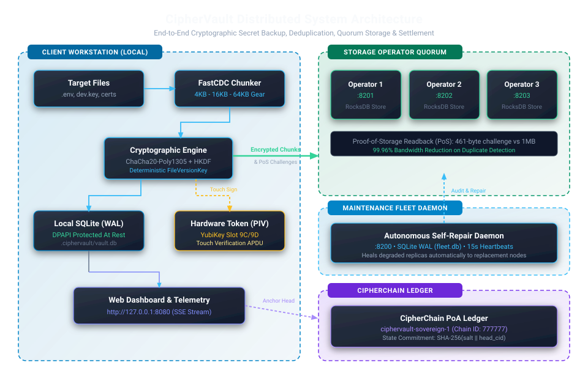
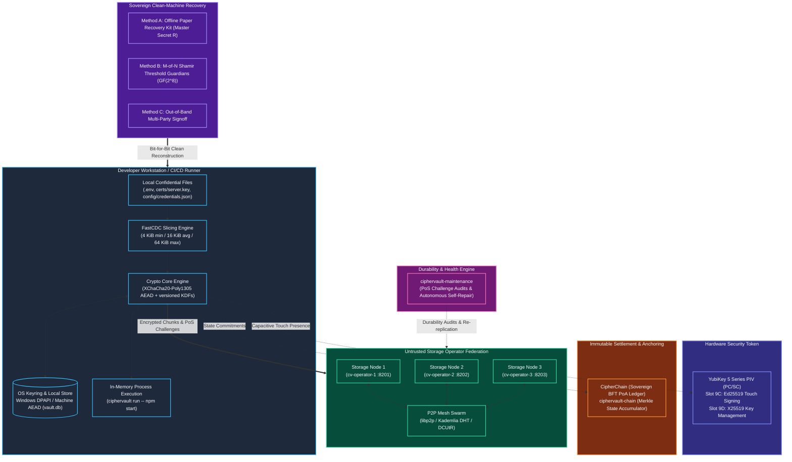

# 🛡️ CipherVault

<div align="center">

[](dist/RELEASE_NOTES.md)
[](https://www.rust-lang.org/)
[](crates/snapshot/CHUNK_PROTOCOL_V2.md)
[](docs/CRYPTOGRAPHIC_AUDIT_SPECIFICATION.md)
[](#-hardware-security-tokens--yubikey-piv)
[](#-verification--quality-gates)
[](LICENSE)
[](SECURITY.md)
[](CONTRIBUTING.md)

**Client-encrypted secret backup, version control, and clean-machine disaster recovery for confidential development files.**

Captures default to [Chunk protocol v2](crates/snapshot/CHUNK_PROTOCOL_V2.md) featuring content-defined chunk deduplication across edits, keyed identifiers (eliminating candidate-file confirmation attacks), and domain-isolated HKDF-SHA256 derivations. Legacy chunk v1 remains supported for backward compatibility (or via CIPHERVAULT_CHUNK_V2_WRITE=0); both versions remain transparently readable. Read the [current security and operational guarantees](docs/CURRENT_SECURITY_GUARANTEES.md) before deploying.

Use version 1.0.28 or newer for complete Protocol v2 defaults and Agentic AI in-memory credential protections. Upgrade reader nodes before deployment; older binaries cannot read newer v2 chunks.

*Git tracks your source code. CipherVault protects everything Git leaves behind.*

[The Problem It Solves](#-the-problem-ciphervault-solves) • [Architecture](#-system-architecture--trust-boundaries) • [Key Features](#-important-features) • [Installation](#-installation-guide) • [Setup Guide](docs/SETUP_GUIDE.md) • [Quickstart Guide](#-quickstart-guide) • [CLI Reference](#-complete-cli-command-reference) • [Disaster Recovery](#-clean-machine-disaster-recovery) • [Docker Deployment](#-docker-compose--self-hosting) • [Docs Hub](docs/README.md) • [Contributing](CONTRIBUTING.md) • [Trademark](TRADEMARK.md)

</div>

---

## 🎯 The Problem CipherVault Solves

### The Developer's Dilemma
Modern software development requires dozens of confidential credentials: `.env` files, API keys, database connection strings, TLS certificates, service account tokens, and private signing keys. 

Developers are taught from day one: **never commit secrets to Git**. We dutifully add them to `.gitignore`. But once secrets are excluded from Git, developers face four critical vulnerabilities:

```text
┌────────────────────────────────────────────────────────────────────────────────────────┐
│                               THE SECRETS DILEMMA                                      │
├───────────────────────────────┬────────────────────────────────────────────────────────┤
│ The Vulnerability             │ The Real-World Risk & Impact                           │
├───────────────────────────────┼────────────────────────────────────────────────────────┤
│ 1. Accidental Git Leaks       │ One careless git commit or git push leaks credentials  │
│                               │ permanently into commit histories and public mirrors.  │
├───────────────────────────────┼────────────────────────────────────────────────────────┤
│ 2. The Clean-Machine          │ When a developer's laptop is lost, damaged, stolen,    │
│    Disaster Nightmare         │ or wiped, Git only restores source code. All unbacked  │
│                               │ local credentials, environment configs, and private   │
│                               │ keys are gone, causing days of manual resets.          │
├───────────────────────────────┼────────────────────────────────────────────────────────┤
│ 3. The Centralized SaaS Trap  │ Centralized cloud vaults (AWS Secrets Manager,         │
│                               │ 1Password, HashiCorp Vault) introduce custodial risks, │
│                               │ subscription costs, internet lock-in, and single       │
│                               │ points of failure for development workflows.           │
├───────────────────────────────┼────────────────────────────────────────────────────────┤
│ 4. Plaintext Disk Exposure &  │ Leaving .env files unencrypted on local disks exposes   │
│    Shoulder Surfing           │ secrets to malware, unauthorized terminal observers,  │
│                               │ and compromised dependency build scripts.              │
└───────────────────────────────┴────────────────────────────────────────────────────────┘
```

---

### How CipherVault Solves It (In Plain English)

Think of CipherVault as a **sovereign, decentralized safety deposit box and time machine for confidential files**:

1. **Client Encryption**: CipherVault encrypts tracked file content using `XChaCha20-Poly1305` before uploading it. Epoch keys leave the device only inside encrypted recovery envelopes.
2. **Content-Defined Chunks (FastCDC)**: Opt-in v2 captures reuse the same encrypted object when padded chunk content is unchanged within a vault and epoch. Reuse depends on the edit and chunk boundaries; small files may fit in a single chunk. Default v1 reuses unchanged whole-file versions.
3. **Storage Operators**: Encrypted chunks are replicated across configured storage nodes. Paths and contents stay encrypted. Operators can observe public vault/epoch headers, chunk equality, object sizes, counts and access patterns; a node count alone does not establish independent failure domains.
4. **Clean-Machine Disaster Recovery**: An offline recovery kit or enough matching guardian shares can reconstruct a remotely replicated snapshot, provided its operators remain reachable and hold the complete recovery set. Signed device authority and ancestry are checked before selecting a recovery head.
5. **Environment Injection**: `ciphervault run` supplies decrypted values to the child process without creating a plaintext secrets file. The child, operating system, crash dumps and swap remain outside this file-writing guarantee.

---

## 🏛 System Architecture & Trust Boundaries

[](docs/diagrams/01_system_architecture.svg)



### Core Security Invariants

* **Protected Local Keys**: Windows protects local device and epoch keys with DPAPI. Other platforms use an authenticated envelope backed by an explicitly configured master key or a private persistent key file. Missing key files are provisioned without overwriting existing or malformed files. Tracked working files, restore backups, paths and database metadata still require disk and account protection.
* **Zero-Plaintext to Storage Operators**: All chunk slicing, manifest generation, and encryption happen strictly on the client workstation. Storage operators receive opaque ciphertext blobs addressed by SHA-256 content identifiers (CIDs).
* **Zero-Disk Master Secret ($R$)**: The 256-bit root recovery secret $R$ is printed exclusively to your terminal upon initialization, requires interactive acknowledgement, and is immediately purged from RAM using memory-zeroizing fences (`ZeroizeOnDrop`).
* **Cryptographic Proof-of-Storage (PoS)**: Remote replica durability is verified using domain-separated nonce challenge-response protocols (`"CIPHERVAULT-POS-V1"`), slashing verification bandwidth by **99.96%** (461 bytes instead of 1 MiB per chunk).
* **Versioned Key Hierarchy**: Recovery descriptors and legacy manifest/file derivations retain the custom Blake2b v1 KDF. Random epoch and device keys are separate. New v2 opaque identifiers and chunk key/nonces use HKDF-SHA256 with explicit vault, epoch and domain bindings.

---

### Workspace Component Anatomy

CipherVault is a modular Rust workspace with operating system cryptography, SQLite and optional smartcard integrations:

| Component | Path | Language / Tech | Primary Responsibility |
|---|---|---|---|
| **CLI & Host** | `apps/cli` | Rust (Clap, Tokio, Axum) | Developer CLI (36 commands), embedded dashboard server, and Ratatui TUI host. |
| **Agent Daemon** | `apps/agent` | Rust (Notify) | Autonomous background file watcher with debounced coherent snapshot capture. |
| **Web Dashboard** | `apps/ui` | HTML5, CSS3, Vanilla JS | Embedded visual secrets explorer, telemetry viewer, diff viewer, and Shamir simulator. |
| **Crypto Core** | `crates/crypto` | Rust (XChaCha20, Ed25519, Dalek) | AEAD primitives, custom Blake2b KDF, constant-time $\text{GF}(2^8)$ Shamir, sealed boxes, PC/SC PIV driver. |
| **Wire Format** | `crates/format` | Rust (Canonical CBOR) | Canonical deterministic serialization for Genesis, Head, Snapshot, and Manifest records. |
| **Snapshot Engine** | `crates/snapshot` | Rust (FastCDC, Gear Hash) | Versioned chunk encryption, reusable v2 objects, and journaled restore with rollback. |
| **Local Store** | `crates/local-store` | Rust (Rusqlite WAL, DPAPI) | Local SQLite state, tracked file registry, snapshot DAG, and device keyrings. |
| **Recovery Primitives** | `crates/recovery` | Rust (Shamir, CRC32) | Paper kit derivation, threshold guardian generation, and out-of-band challenge approval. |
| **Storage Client** | `crates/storage` | Rust (Reqwest, Futures) | Concurrent multi-operator replication pool, PoS verification, and sovereign anchor clients. |
| **Storage Operator** | `services/operator` | Rust (Axum, Tokio) | Zero-knowledge chunk store, PoS challenge responder, and P2P peer gossip. |
| **Maintenance Fleet** | `services/maintenance` | Rust (Tokio, Rusqlite) | Periodic replication auditor, node latency monitor, and autonomous self-repair scheduler. |
| **Account Service** | `services/account` | Rust (Axum, WebAuthn) | Optional self-hosted multi-device synchronization, passkey enrollment, and TOTP alternate login. |
| **Sovereign Ledger** | `crates/chain` | Rust (Ed25519, Sha2) | Zero-gas Proof-of-Authority consensus ledger, Merkle state accumulator, and sub-millisecond light client verifier. |
| **EVM Legacy (removed)** | *deleted in Phase 1* | Sovereign migration | Contracts/Foundry deleted; historical anchors in git tag `last-evm-anchor`. |

---

## ✨ Important Features

### 🔐 Cryptographic Sovereignty
* **Authenticated Client Encryption**: File payloads use `XChaCha20-Poly1305` (256-bit key, 192-bit nonce); header fields are authenticated and whole-file digest/order/length checks precede restore.
* **Opaque v2 Identifiers (Opt-In)**: Operators address encrypted CBOR objects by SHA-256 CID. Keyed v2 identifiers prevent public candidate-file hashing from matching v2 metadata; deterministic equality, object lengths, epoch/vault and access patterns remain visible. Default v1 and old snapshots retain their public candidate-confirmation limitation; enabling v2 does not erase history.
* **Memory Scrubbing**: Sensitive owned buffers use zeroization on release and error paths. This reduces retention; it does not prevent the OS or child processes from copying secrets.

### 🧩 Content-Defined Chunking (FastCDC)
* **Gear Rolling Hash**: Byte-level sliding window with compile-time `SplitMix64` lookup tables dynamically determines chunk boundaries (4 KiB min, 16 KiB avg, 64 KiB max).
* **Encrypted Chunk Reuse**: Unchanged v2 chunks retain their CIDs across edits and moves within the same vault and epoch, including repeated chunks in one file. Changing epochs or vaults deliberately changes their addresses. Historical v1 chunks bind the entire file version and do not provide this edit reuse.

### 📜 Clean-Machine Disaster Recovery
* **Emergency Offline Paper Recovery Kit**: Generates an interactive terminal recovery sheet containing Master Secret $R$ and a CRC32 checksum. Print or write this down once to restore your entire secret vault onto any new computer.
* **$M$-of-$N$ Shamir Threshold Guardians**: Split Master Secret $R$ across $N$ trusted teammates (e.g. 3-of-5). Any $M$ guardian shares can reconstruct the vault in memory using constant-time $\text{GF}(2^8)$ polynomial interpolation.
* **Out-of-Band Multi-Party Approvals**: Require cryptographic signatures from designated team leads before executing high-risk recoveries on clean or untrusted hardware (`ciphervault approve`).

### 🚀 Zero-Disk Process Execution (`ciphervault run`)
* **In-Memory Environment Injection**: Launch child processes (`npm start`, `cargo run`, `python app.py`, `docker compose up`) with decrypted secrets directly injected into their volatile process environment.
* **Zero Plaintext on Disk**: No plaintext `.env` files ever touch physical storage media.
* **Hermetic Isolation**: Strip existing host environment variables (`--no-inherit`) or inject runtime overrides (`--set PORT=8080`).

### 👁️ Shoulder-Surfing Safe Secret Diffing (`ciphervault diff`)
* **Masked by Default**: Inspect additions, deletions, and key modifications between snapshots or your working tree without exposing plaintext secret values on screen.
* **Private Reveal Mode**: Explicitly reveal unmasked values only when working in a secure environment with `--reveal`.
* **Auditable JSON Output**: Generate structured machine-readable reports for security pipelines and CI audits (`--json`).

### 🔑 Hardware Security Tokens (YubiKey PIV)
* **Native ISO 7816-4 APDU Driver**: Direct communication over platform PC/SC (`winscard.dll` on Windows, pcsc-lite on Linux/macOS) with zero external C dependencies.
* **Hardware-Bound Signing**: Private identity keys are locked in YubiKey PIV Slot 9C and never exported.
* **Capacitive Touch Presence**: Enforce physical finger touch on the security key before signing snapshot commits (`ciphervault push --touch`).

### 🖥️ Dual User Interfaces
* **Interactive Terminal UI (TUI)**: Fast, full-screen terminal interface powered by Ratatui and Crossterm with 6 views: Overview, Files, History, Operators, FastCDC chunk distribution, and Hardware Token telemetry (`ciphervault tui`).
* **Embedded Web Dashboard & Explorer**: Self-contained local web dashboard with zero tracking or external CDN dependencies for visually exploring chunk graphs, diffing secrets, and simulating Shamir ceremonies (`ciphervault ui`).

### ⏱️ Autonomous File Watcher Daemon (`ciphervault watch`)
* **OS-Level File Event Hook**: Listens to native filesystem change notifications using the `notify` crate.
* **Intelligent Debouncing & Coherent Reads**: Waits for writes to settle (default: 2 seconds) and verifies coherent reads before automatically creating FastCDC snapshots and replicating them to operators.
* **Missed-Event Recovery**: A three-second fallback scan compares tracked content with the committed manifest. Detection never acknowledges uncaptured bytes; failed captures remain dirty. Native events and queued capture jobs are bounded/coalesced, while a separate worker handles uploads and allows shutdown cancellation.
* **Historical Epochs and Restore**: Restore, diff and legacy run load each snapshot's recorded epoch key. Restores stage all verified files and backups in a private journal directory, then publish with per-file atomic replacement and rollback on failure. See the [transaction limits](docs/CURRENT_SECURITY_GUARANTEES.md#capture-restore-and-execution).

### 🚫 Git Leak Prevention Hook (`ciphervault hook`)
* **Automated `.gitignore` Sync**: Adding confidential files via `ciphervault track` automatically ensures they are excluded in `.gitignore`.
* **Pre-Commit Enforcement**: Installable Git pre-commit hook blocks accidental staging or committing of confidential files.

### ⛓️ Tamper-Evident Sovereign State Anchoring
* **Sovereign CipherChain Anchoring**: Anchor cryptographic state commitments directly to CipherVault's native zero-gas Proof-of-Authority blockchain with Byzantine fault tolerant quorum signatures, Merkle audit proofs, and sub-millisecond local verification.
* **Immutable Ledger Proofs**: Persist sovereign block inclusion proofs locally to mathematically prove vault state integrity at any historical point in time.

---

## 📦 Installation Guide

### Prerequisites
* **Operating System**: Windows 10/11, macOS (Apple Silicon or Intel), or Linux (Ubuntu, Debian, Fedora, Arch).
* **Rust Toolchain**: Rust `1.89.0` or newer (if building from source).
* **PC/SC Smartcard Service**: (Optional, only for YubiKey PIV hardware token features). Enabled by default on Windows (`winscard`); install `pcscd` on Linux.

---

### Option 1: Install Pre-Built Binary

#### Windows (PowerShell)
```powershell
irm https://raw.githubusercontent.com/samuel-1-avson/CipherVault/main/dist/scripts/install.ps1 | iex
```

#### macOS & Linux (Bash)
```bash
curl -fsSL https://raw.githubusercontent.com/samuel-1-avson/CipherVault/main/dist/scripts/install.sh | bash
```

> Private repo: the commands above need a token until the repo is public.
> Create a fine-grained personal access token with **Contents: read-only**
> on this repo, export it as `CIPHERVAULT_GITHUB_TOKEN` (`GH_TOKEN` /
> `GITHUB_TOKEN` also work), and add the auth header to the bootstrap
> fetch — the installer reuses the variable for the release download:
>
> ```powershell
> $env:CIPHERVAULT_GITHUB_TOKEN = '<paste-token-here>'
> $h = @{ Authorization = "Bearer $env:CIPHERVAULT_GITHUB_TOKEN" }
> irm -Headers $h https://raw.githubusercontent.com/samuel-1-avson/CipherVault/main/dist/scripts/install.ps1 | iex
> ```
>
> ```bash
> export CIPHERVAULT_GITHUB_TOKEN='<paste-token-here>'
> curl -fsSL -H "Authorization: Bearer $CIPHERVAULT_GITHUB_TOKEN" \
>   https://raw.githubusercontent.com/samuel-1-avson/CipherVault/main/dist/scripts/install.sh | bash
> ```
>
> `ciphervault update` reads the same variable.

---

### Option 2: Install via Cargo (Recommended for Rust Developers)

Install the CLI binaries (`ciphervault` plus its short alias `cv` — same tool, two names) directly from Git into your Cargo bin path:

```bash
cargo install --git https://github.com/samuel-1-avson/CipherVault.git ciphervault-cli
```

Ensure `~/.cargo/bin` (or `%USERPROFILE%\.cargo\bin` on Windows) is in your system's `PATH`.

---

### Option 3: Build From Source

Clone the repository and compile optimized release binaries for the entire workspace:

```bash
git clone https://github.com/samuel-1-avson/CipherVault.git
cd CipherVault

# Compile all workspace binaries with release optimizations
cargo build --workspace --release --locked
```

Compiled binaries will be available in `target/release/`:
* `ciphervault` — Main developer CLI, embedded web dashboard, and Ratatui TUI.
* `cv` — Short alias for the main CLI (same tool; use whichever name you prefer).
* `ciphervault-operator` — Zero-knowledge federated storage node service.
* `ciphervault-maintenance` — Autonomous replication auditor and self-repair daemon.
* `ciphervault-agent` — Background filesystem watcher daemon.
* `ciphervault-account` — Optional self-hosted account and device identity service.

---

### Short alias: `cv`

Every install ships two names for the same tool: `cv` and `ciphervault`.
`cv init`, `cv push`, `cv --help` all work, and `ciphervault` keeps working
everywhere it always has. (Installs from before the alias shipped only have
`ciphervault`; update, then rerun the installer once to pick up `cv`.)

---

### Shell Autocompletions

Generate native, high-performance autocompletions for your shell.
Each command name has its own script: `cv completions ...` completes `cv`, `ciphervault completions ...` completes `ciphervault`.

```bash
# PowerShell (add to your $PROFILE)
cv completions powershell | Out-String | Invoke-Expression

# Bash
eval "$(cv completions bash)"

# Zsh
eval "$(cv completions zsh)"

# Fish
cv completions fish > ~/.config/fish/completions/cv.fish
```

---

## ⚡ Quickstart Guide

### 1. Start a Local 3-Node Storage Cluster

CipherVault replicates encrypted chunks across independent storage operators. For local development or testing, spin up a 3-node cluster using Docker Compose:

```bash
# Start 3 storage operators, maintenance scheduler, and dashboard
docker compose up -d
```

*(Alternatively, run three local operator instances manually: `ciphervault-operator --port 8201 --data-dir ./data/op1 --operator-id op_8201`)*

---

### 2. Initialize a Vault in Any Project

Navigate to any project directory containing confidential files (`.env`, certificates, tokens):

```bash
cd ~/my-project

# Initialize vault with the local 3-node operator cluster
ciphervault init --operators http://127.0.0.1:8201 http://127.0.0.1:8202 http://127.0.0.1:8203 --import-gitignore
```

> [!IMPORTANT]
> **RECORD YOUR EMERGENCY RECOVERY KIT!**
> CipherVault will display your **Offline Emergency Recovery Kit** (containing Master Secret $R$). Write this key down and store it in a secure location. In accordance with CipherVault's zero-disk recovery policy, $R$ is immediately scrubbed from volatile RAM and is never written unencrypted to disk.

---

### 3. Track Confidential Files & Capture Encrypted Snapshot

```bash
# Track confidential files (automatically adds them to .gitignore)
ciphervault track .env certs/server.key config/credentials.json

# Check vault status and tracked files
ciphervault status

# Slice (FastCDC), encrypt (XChaCha20-Poly1305), and replicate snapshot across all 3 operators
ciphervault push -m "Initial production environment"
```

Every push performs a per-object **Proof-of-Storage** challenge readback, both as pre-upload dedup (objects with a valid proof are not re-uploaded) and as mandatory post-upload verification before a replica counts toward quorum.

---

### 4. Zero-Disk In-Memory Execution (`ciphervault run`)

> **New projects start elsewhere:** bare snapshot-mode `run` (below) is legacy and prints a `LEGACY_PATH_DEPRECATED` warning. Run `ciphervault migrate plan` first to adopt scoped secrets, then `run` resolves from your project — or pass `--legacy` to keep the old behavior explicitly.

Run your applications with secrets directly injected into their process environment in volatile RAM **without ever writing plaintext `.env` files to disk**:

```bash
# Node.js
ciphervault run -- npm start

# Python
ciphervault run -- python main.py

# Docker Compose
ciphervault run -- docker compose up

# Hermetic isolation (strip host environment variables)
ciphervault run --no-inherit -- python script.py

# Dry-run inspection (view decrypted variable keys without exposing values)
ciphervault run --dry-run -- node server.js
```

---

### 5. Safe Secret Diffing (`ciphervault diff`)

Compare changes in your confidential files with automatic shoulder-surfing protection:

```bash
# View masked diff against active snapshot head (values hidden)
ciphervault diff

# Reveal plaintext values in a secure private terminal
ciphervault diff --reveal

# Diff between two historical snapshot revisions
ciphervault diff <snapshot_id_1> <snapshot_id_2>
```

---

### 6. Interactive Terminal User Interface (TUI)

Launch the full-screen terminal dashboard:

```bash
ciphervault tui
```

* **`[1] Overview`**: Active snapshot head, epoch age, tracked file count, and storage quorum status.
* **`[2] Files`**: Browse tracked confidential files, byte sizes, and modification timestamps.
* **`[3] History`**: Interactive snapshot DAG history with commit messages and CIDs.
* **`[4] Operators`**: Real-time roundtrip latency gauges, healthy/degraded replica states, and PoS status.
* **`[5] FastCDC`**: Content-defined chunk distributions and deduplication efficiency graphs.
* **`[6] Token`**: Hardware token reader presence, PIV slot status, and touch policies.
* **Hotkeys**: Press `[p]` to commit and push a new snapshot; press `[a]` to anchor to CipherChain; press `[q]` to quit.

---

### 7. Embedded Web Dashboard & Secrets Explorer

Launch the local web dashboard for visual exploration:

```bash
ciphervault ui --port 8080
```

Open **`http://127.0.0.1:8080`** in your browser to inspect chunk graphs, review telemetry, and test recovery ceremonies.

---

### 8. Autonomous File Watcher Daemon (`ciphervault watch`)

Run the background file watcher to automatically capture snapshots whenever you save a tracked secret:

```bash
# Watch with 2-second debounce and auto-sync replication
ciphervault watch --debounce 2 --sync
```

Whenever you modify and save `.env` in your code editor, CipherVault debounces for 2 seconds, verifies a coherent read, creates a FastCDC snapshot, and replicates the encrypted chunks to all operators automatically.

---

### 9. Hardware Security Token Signing (YubiKey PIV)

Bind snapshot commit signatures to a physical YubiKey 5 Series hardware token:

```bash
# Probe attached smartcard readers
ciphervault token probe

# Initialize vault binding device identity to physical token
ciphervault init --hardware-token

# Push snapshot requiring physical capacitive touch
ciphervault push -m "Hardware-verified commit" --touch
```

When `--touch` is enabled, host execution pauses until you physically touch the metal contact on your YubiKey. The private signing key never leaves the smartcard secure element.

---

### 10. Vault Health Check (`ciphervault doctor`)

Run an automated self-diagnostic check on your local vault configuration, OS keyring security, operator reachability, quorum consistency, and anchor freshness:

```bash
ciphervault doctor
```

---

## 🛡 Clean-Machine Disaster Recovery

If your workstation is lost, stolen, or destroyed, CipherVault enables complete secret restoration onto a clean replacement computer without access to any prior databases or cloud coordinators.

### Method A: Single Emergency Paper Recovery Kit

Restore all confidential files using your printed Master Secret $R$:

```bash
ciphervault recover --kit emergency_recovery_kit.txt --to ./restored_secrets/
```

CipherVault contacts the storage operators, downloads the encrypted chunks, reconstructs the key hierarchy in memory, decrypts each file, and restores them with bit-for-bit fidelity.

---

### Method B: Threshold Guardian Reconstruction ($M$-of-$N$ Shamir)

For team environments, split the master recovery secret so that no single person can recover the vault alone:

```bash
# Generate 3 printable guardian sheets where any 2 are required to recover
ciphervault recovery split --threshold 2 --shares 3 --out-dir ./guardians
```

To recover on a clean machine, combine any $M$ guardian shares:

```bash
ciphervault recover --shares guardian_share_1_of_3.txt guardian_share_3_of_3.txt --to ./restored_secrets/
```

* **Constant-Time $\text{GF}(2^8)$ Arithmetic**: Polynomial Lagrange interpolation executes entirely in volatile memory with zero secret-dependent branches.
* **Zero Disk Exposure**: Secret $R$ is never written to disk during or after recovery.
* **100% Bit-for-Bit Identity**: All restored files are verified against original SHA-256 digests.

---

### Method C: Out-of-Band Multi-Party Gated Recovery

Enforce cryptographic approval receipts before restoring secrets onto untrusted hardware:

```bash
# Initiates a 600-second authorization challenge on the operator cluster
# (--approver-key pins whose receipts are accepted; without it recovery bails)
cv recover --kit emergency_recovery_kit.txt --to ./restored_secrets/ --require-approval --approver-key <TEAM_LEAD_PUBKEY_HEX>
```

An authorized team lead signs and approves the challenge from their enrolled device:

```bash
# Team lead inspects and approves the challenge
cv approve list
cv approve sign <CHALLENGE_ID>
```

---

## 💻 Complete CLI Command Reference

| Command | Key Arguments & Flags | Description |
|---|---|---|
| `ciphervault init` | `[-f/--force] [-o/--operators <URL...>] [--save-kit <PATH>] [--hardware-token] [-i/--import-gitignore] [--reader <NAME>] [--pin <PIN>]` | Initializes a new vault, derives key hierarchy, prints paper recovery kit, and scans `.gitignore` for secrets. |
| `ciphervault track` | `[PATH...] [--from-gitignore] [--no-gitignore] [--allow-planned]` | Registers confidential files for snapshot tracking; automatically appends to `.gitignore` to prevent leaks. Missing paths are an error unless `--allow-planned`. |
| `ciphervault untrack` | `<PATH...>` | Stops tracking specified confidential files. |
| `ciphervault status` | `[--json] [--overview]` | Displays active vault metadata, tracked files, and active epoch. `--overview` adds snapshots, files, leases, anchors, and recent activity. |
| `ciphervault push` | `[-m/--message <MSG>] [--touch] [--local] [--anchor] [--concurrency <N>] [--replicas <N>] [--reader <NAME>] [--pin <PIN>]` | Slices files with FastCDC, encrypts, and replicates across operators with mandatory PoS readback verification; hardware touch optional. |
| `ciphervault pull` | `[-d/--dry-run] [-f/--force]` | Pulls and applies latest verified snapshots from storage operators. `--dry-run` checks without modifying local files. |
| `ciphervault history` | *None* | Displays the snapshot commit DAG history. |
| `ciphervault run` | `[-s/--snapshot <HEX>] [-e/--env-file <FILE>] [--project <SLUG>] [--env <ENV>] [--revision <64HEX>] [--endpoint <URL>] [--token <TOK>] [--legacy] [--no-inherit] [--dry-run] [-q/--quiet] [--json] [--set <K=V...>] -- <CMD...>` | Injects decrypted secrets directly into child process environment in volatile RAM (zero disk exposure). Scoped mode (`--project/--env`, optional `--revision`) fetches from the account service; `--legacy` keeps snapshot mode explicitly. |
| `ciphervault diff` | `[<SNAPSHOT_A>] [<SNAPSHOT_B>] [-f/--file <PATH>] [--reveal] [--json]` | Compares confidential file changes with shoulder-surfing masking enabled by default. |
| `ciphervault restore` | `[-s/--snapshot <HEX>] [-t/--to <DIR>] [--dry-run] [--force] [--hardware-token] [--reader <NAME>] [--pin <PIN>]` | Verifies a historical snapshot, previews without writes or publishes a journaled merge restore. Restoring into the workspace refuses on dirty files unless `--force`. |
| `ciphervault recover` | `[-k/--kit <PATH>] [--shares <PATH...>] -t/--to <DIR> [--require-approval] [--approver-key <HEX...>] [--force]` | Reconstructs confidential files on a clean machine using a paper kit or $M$-of-$N$ threshold guardian shares. `--approver-key` (repeatable) pins whose receipts are accepted with `--require-approval`. |
| `ciphervault recovery split` | `-t/--threshold <M> -s/--shares <N> [--kit <PATH>] [-o/--out-dir <DIR>] [--stdout]` | Splits master recovery secret $R$ into printable Shamir paper guardian sheets. Requires `--out-dir` (or explicit `--stdout`); never retypes the secret by hand. |
| `ciphervault recovery show-descriptors` | *(alias: `export`)* | Displays public descriptors (signing PK, encryption PK, locator) without exposing secret $R$. This is NOT the secret kit — plus a lost-kit triage checklist. |
| `ciphervault recovery test` | `[-k/--kit <PATH>] -t/--to <DIR>` | Clean-restore drill into an isolated folder. |
| `ciphervault recovery key-backup` | `[-k/--kit <PATH>] [-s/--share <PATH...>] [--replicas <N>]` | Seals the kit (or threshold shares) with a passphrase and stores it on operators. |
| `ciphervault recovery key-restore` | `-l/--locator <64HEX> -o/--output <PATH> [--operator <URL...>]` | Fetches a passphrase-sealed kit backup (output must not exist). |
| `ciphervault prune` | `[--keep-last <N>] [--keep-days <D>] [--dry-run]` | Cleans up historical snapshots and performs chunk garbage collection per retention policy. |
| `ciphervault rekey` | `[--check] [--warn-days <D>]` | Rotates the vault epoch key and re-encrypts envelopes. |
| `ciphervault doctor` | `[--json]` | Runs comprehensive local diagnostics across vault state, OS keyring, operators, quorum, anchors, and recovery coverage. |
| `ciphervault tui` | `[--poll-ms <MS>]` | Launches interactive full-screen Terminal User Interface dashboard. |
| `ciphervault ui` | `[--host <ADDR>] [-p/--port <PORT>] [--no-browser] [--local] [--serve] [--url <URL>]` | Launches embedded Web Dashboard and Visual Secrets Explorer. `--local` serves the offline inspector; otherwise opens the production dashboard. |
| `ciphervault watch` | `[-d/--debounce <SECS>] [-s/--sync] [--dry-run]` | Listens to OS filesystem save events on tracked secrets; auto-snapshots and pushes on save. |
| `ciphervault anchor` | `[--head <CID>] [--daemon] [--interval <SECS>] [--rotate-to <KEYS>]` | Computes a salted state commitment and anchors to the CipherChain sovereign blockchain. `--rotate-to` (comma-separated member pubkeys) proposes a validator-set rotation taking effect next height. |
| `ciphervault verify-anchor` | `[--head <CID>]` | Verifies cryptographic state commitment, Merkle audit path, and operator quorum signatures locally in <1ms. |
| `ciphervault genesis` | `propose / sign / assemble` *(v1.0.29+; not in 1.0.28 binaries)* | Multi-party genesis ceremony: deterministic unsigned proposal, per-member device-key signatures, founder combines quorum into a chain dir. |
| `ciphervault publish-public-feed` | `-o/--output <PATH> [--network <LABEL>]` | Publishes a signed public checkpoint feed from local vault evidence for the public explorer. |
| `ciphervault audit` | `[-o/--operators <URL...>] [--export-inventory <PATH>] [--operator-pin <ENDPOINT=64HEX...>] [--recovery-drill]` | Audits ciphertext availability; the explicit drill fetches pinned remote objects and verifies plaintext in memory with historical local epoch keys. |
| `ciphervault repair` | `[-o/--operators <URL...>] [--replicas <N>]` | Detects degraded replicas and self-heals by streaming missing chunks from surviving operators. |
| `ciphervault peers` | `[-d/--discover] [--mesh]` | Queries operators to inspect active nodes, dynamically discover peers via P2P gossip, or mesh routing tables via announce. |
| `ciphervault lease create` | `<CLOSURE_64HEX> <BYTES> [--term-days <N>] [-o/--operator <URL>]` | Commits a storage lease for a closure digest on one operator (device session auth). |
| `ciphervault lease renew` | `<LEASE_ID> <DAYS> <BYTES> [-o/--operator <URL>]` | Renews an existing lease for additional days. |
| `ciphervault lease list` | `[--limit <N>] [-o/--operator <URL>]` | Lists this vault's leases on one operator (merges into the local receipt log). |
| `ciphervault voucher issue` | `<HOLDER_PK_64HEX> <QUOTA> [--ttl <SECS>] [-o/--operator <URL>]` | Issues a write voucher from an operator (needs `CIPHERVAULT_OPERATOR_SERVICE_TOKEN`). |
| `ciphervault invite` | `pubkey/issue/join/refresh/request/approve/combine/verify/requests/apply/decide` | Fleet-signed join tickets. Solo: `pubkey --fleet-key-file <SEED>`, `issue --fleet-key-file <SEED> <NODE_PK> [--keys-file <PATH>] [--ttl <S>] [--out <PATH>]`: `join --node <OWN_URL> <TICKET> [--via <URL...>]`, `refresh --node <OWN_URL> [--via <URL...>]`. Quorum: `request <NODE_PK> [--ttl <S>] [--out <PATH>]`, `approve --request <REQ> --fleet-key-file <SEED> [--out <PATH>]`, `combine --request <REQ> --approval <FILE...> [--out <PATH>]`, `verify --fleet-keys <K1,K2...> [--quorum-k <K>] <TICKET>`. Control-plane: `requests [--via <URL...>]`, `decide <REQ_ID> approved/rejected [--via <URL...>]`, `apply --node <OWN_URL> [--contact <STR>] [--via <URL...>]`. |
| `ciphervault node` | `setup [--name <N>] [--data-dir <DIR>] [--port <P>] [--yes] [--join-ticket <PATH>] [--no-start] [--p2p [--p2p-bootstrap <ADDR>...]]` + `start/stop/status/standing/p2p-info [--data-dir <DIR>]`, `backup --to <DIR> [--data-dir <DIR>]` | Run a storage node: guided first-run wizard, lifecycle, plain-language health and fleet-standing reports, identity backup, and P2P peering info. |
| `ciphervault approve` | `list` / `sign <CHALLENGE_ID> [-n/--name <ROLE>]` / `status <CHALLENGE_ID>` | Out-of-band cryptographic authorization for high-risk operations. |
| `ciphervault token` | `status/probe/list/slots [-r/--reader <NAME>]` + `pin [-p/--pin <PIN>] [--test] [--clear]` + `select [-r/--reader <NAME>]` | Inspects attached PC/SC smartcard readers, PIV slots, and touch policies; tests/caches or clears the cached PIN; persists the default reader. |
| `ciphervault hook install` | `[--force]` | Installs the Git pre-commit hook; refuses to clobber a foreign hook unless `--force` (backed up first). |
| `ciphervault hook check` | `[-d/--deep] [-f/--fix] [--json]` | Checks staged confidential files, secret sprawl, and unbacked modifications; `--fix` appends discoveries to `.gitignore`. |
| `ciphervault auth` | `init [--name <NAME>]` / `connect [--endpoint <URL>] [--label <STR>] [--vault-alias <STR>]` / `login` / `logout` / `status` | Manages the optional local account and device identity; `connect` registers with the hosted account service. |
| `ciphervault device` | `list` / `revoke <DEVICE_ID_32BHEX>` / `export-key <OUT>` (refuses to overwrite) / `import-keys <BUNDLE>` | Lists or revokes enrolled devices; exports/imports a passphrase-sealed device + epoch-key bundle. |
| `ciphervault vault` | `link [--alias <NAME>]` / `unlink` | Binds or removes the local vault from the account registry. |
| `ciphervault repo` | `bind --project <SLUG> --provider <github/gitlab/bitbucket/self-hosted> --repo-id <ID> --name <ORG/REPO> --url <URL> [--installation-id <ID>]` / `list --project <SLUG>` / `unbind --project <SLUG> [--binding <ID> or --provider <P> --repo-id <ID>] [--revoke] [--reason <STR>]` | Binds VCS repositories to a project by immutable provider id (suspend default, revoke terminal). |
| `ciphervault context` | `show` / `set [--project <SLUG>] [--env <ENV>]` / `clear` | Inspects and edits the local scope context file. |
| `ciphervault project` | `list` / `show <SLUG>` / `use <SLUG>` | Lists and resolves scoped-secret projects; `use` pins the context file (clears the environment). |
| `ciphervault secret` | `set <NAME> [--value <STR> or --value-stdin] [--type <T>] [--description <STR>] [--tag <T...>] [--repo-binding <ID>] [--service <ID>]` / `get <NAME> [--meta]` / `list [--tag <T...>] [--status <S>] [--limit <N>]` / `find <QUERY>` / `update [NAME] [--id <ID>] [--description <STR>] [--tag <T...>] [--status <S>] [--expires-at <RFC3339>]` / `delete [NAME] [--id <ID>] [--reason <STR>]` / `rotate [NAME] [--id <ID>] [--value <STR> or --value-stdin] [--reason <STR>] [--idempotency-key <KEY>]` (+ `--project/--env/--endpoint/--token` on each) | Manages scoped secrets (values rotate, never patch; `find` searches names only, never values). |
| `ciphervault migrate` | `plan [--vault <DIR>] --project <SLUG> [--default-env <ENV>] [--ack-production] [--dry-run] [--snapshot <HEX>]` / `apply --migration-id <ID>` / `verify --migration-id <ID>` / `resolve --migration-id <ID> --entry <ID> [--rename <NAME>] [--env <ENV>]` / `shred-legacy --confirm <SLUG>` | Migrates a legacy vault into scoped secrets (ledgered: plan, apply, verify, resolve, shred). |
| `ciphervault completions` | `<bash/elvish/fish/powershell/zsh>` | Emits native shell autocompletion for the name invoked (`cv` vs `ciphervault` have separate scripts). |
| `ciphervault update` | `[--check] [--reinstall]` | Checks for and installs the latest signed GitHub release. `--reinstall` repairs even when already current. |

---

## 🐳 Docker Compose & Self-Hosting

CipherVault includes container configurations for a self-hosted storage federation. Strict operator enrollment and independently obtained identity pins must be configured; see [security and deployment guarantees](docs/CURRENT_SECURITY_GUARANTEES.md#operator-authentication-and-pins).

```bash
# Start 3-node storage federation, maintenance scheduler, and dashboard
docker compose up -d

# Check cluster status and health checks
docker compose ps

# Access embedded Web Dashboard
open http://localhost:8080
```

### Services Deployed

| Service | Container Name | Port | Description |
|---|---|---|---|
| `operator-1` | `ciphervault-operator-1` | `8201` | Primary zero-knowledge storage node |
| `operator-2` | `ciphervault-operator-2` | `8202` | Secondary zero-knowledge storage operator |
| `operator-3` | `ciphervault-operator-3` | `8203` | Tertiary zero-knowledge storage operator |
| `maintenance` | `ciphervault-maintenance` | Internal | Periodic replication auditor & SQLite `fleet.db` self-repair daemon |
| `account` | `ciphervault-account` | `8300` | Optional self-hosted account plane with WebAuthn passkeys & TOTP alternate login |
| `dashboard` | `ciphervault-dashboard` | `8080` | Self-contained visual explorer & dashboard |

### Self-Hosted Multi-Server Deployment
For production deployments across independent servers or private clouds, deploy `ciphervault-operator` across 3+ distinct physical or virtual machines behind an HTTPS reverse proxy (such as Caddy or Nginx) with mutual TLS or bearer token authorization. Each operator requires only a persistent data directory and a single open port.

### Join the Fleet as an Operator
New operators start with the guided wizard (`ciphervault node setup` answers three questions, then starts the node), send their node public key to a fleet admin, and present the resulting ticket (`ciphervault invite join`) to enter probation — full trust after a day of uptime. Full ceremony: [operator playbook §10](docs/OPERATOR_PLAYBOOKS.md), [workflow guide Part 3](docs/WORKFLOW_GUIDE.md), and the [public testnet notes](docs/TESTNET.md).

---

## 📊 Performance Benchmarks

Historical x86_64 release measurements below describe the earlier implementation. They are workload examples, not v2 performance or universal deduplication guarantees; remeasure after protocol changes:

| Metric | Measured Value | Benchmark Description / Comparison |
|---|---|---|
| **Chunk+Encrypt Pipeline** | **362.21 MiB/s** | End-to-end FastCDC chunking + `XChaCha20-Poly1305` AEAD (`throughput_benchmark`) |
| **Decryption Throughput** | **669.74 MiB/s** | Streaming in-memory decrypt + reassembly, byte-identical round-trip |
| **FastCDC Boundary Reuse** | **96.15%** | Historical fixture preserved 25/26 plaintext chunks; v2 encrypted reuse is tested separately |
| **PoS Readback Wire Reduction** | **99.956%** | Reduced from 1,048,576 bytes to 461 bytes per 1 MiB chunk |
| **Concurrent Push Speedup** | **3.17x** | 8-way vs sequential replication, 48 x 16 KiB objects on 3 loopback operators (`push_bench`) |
| **Integrity Fidelity** | **100.00%** | Zero bitflips across all chaos failure and recovery drills |

---

## 🧪 Verification & Quality Gates

CipherVault enforces strict zero-warning compilation and comprehensive multi-layer testing across cryptography, networking, and UI:

```bash
# Execute the current workspace test suite; consult CI for the actual result
cargo test --workspace --locked

# Strict static analysis & linter enforcement (zero warnings policy)
cargo clippy --workspace --all-targets --locked -- -D warnings

# Formatting compliance check
cargo fmt --all -- --check

# Single-page UI headless regression suite
node apps/ui/audit.test.cjs

# Real Chrome/Edge CSP regression (browser required; override CIPHERVAULT_TEST_BROWSER)
node apps/ui/csp.browser.test.cjs

# Sovereign CipherChain regression suite
cargo test -p ciphervault-chain -p ciphervault-cli
```

---

## 📚 Further Documentation

For deep technical specifications, audit reports, and deployment guides, explore the documentation hub in [`docs/`](docs/README.md):

* [**`WORKFLOW_GUIDE.md`**](docs/WORKFLOW_GUIDE.md) — Operator network overview, day-to-day user flow, and the run-a-node guide (Part 3).
* [**`OPERATOR_PLAYBOOKS.md`**](docs/OPERATOR_PLAYBOOKS.md) — Fleet operations: restart, mesh, vouchers, backup/restore, and the verified-join ceremony (§10).
* [**`TESTNET.md`**](docs/TESTNET.md) — Public testnet endpoints, join flow, and known issues.
* [**`SYSTEM_WORKFLOW.md`**](docs/SYSTEM_WORKFLOW.md) — Comprehensive architectural deep dive, cryptographic key hierarchy, and end-to-end sequence diagrams.
* [**`CRYPTOGRAPHIC_AUDIT_SPECIFICATION.md`**](docs/CRYPTOGRAPHIC_AUDIT_SPECIFICATION.md) — Mathematical specifications, constant-time $\text{GF}(2^8)$ arithmetic, and threat boundary models.
* [**`DEPLOYMENT_RUNBOOK.md`**](docs/DEPLOYMENT_RUNBOOK.md) — Production operations, multi-node deployment, reverse proxy hardening, and TLS configuration.
* [**`CICD_INTEGRATION.md`**](docs/CICD_INTEGRATION.md) — Zero-disk secret injection guides for GitHub Actions, GitLab CI, and CircleCI.
* [**`SECURITY_AUDIT_REPORT.md`**](dist/SECURITY_AUDIT_REPORT.md) — Security review findings and verification evidence.

---

## 🤝 Community, Governance & Contributing

CipherVault is an open-source, community-driven cryptographic project. We welcome developers, security researchers, cryptographers, and node operators to collaborate and contribute.

* **[Contributing Guidelines](CONTRIBUTING.md)** — Pull request workflow, local development setup, code quality gates, and commit signing conventions.
* **[Developer Certificate of Origin (DCO)](CONTRIBUTING.md#developer-certificate-of-origin-dco)** — How to sign off on commits (`git commit -s`) to certify code provenance and defend against intellectual property theft.
* **[Security Policy & Vulnerability Disclosure](SECURITY.md)** — Coordinated vulnerability reporting guidelines, Safe Harbor policy, and disclosure SLAs.
* **[Code of Conduct](CODE_OF_CONDUCT.md)** — Community standards and harassment-free pledge.
* **[Trademark & Brand Policy](TRADEMARK.md)** — Guidelines on using the CipherVault name and logo, rebranding requirements for forks, and protecting the project's identity.

---

## 📄 License & Trademark Notice

CipherVault is dual-licensed under either of:

* **Apache License, Version 2.0** ([`LICENSE-APACHE`](LICENSE-APACHE) or [http://www.apache.org/licenses/LICENSE-2.0](http://www.apache.org/licenses/LICENSE-2.0))
* **MIT License** ([`LICENSE-MIT`](LICENSE-MIT) or [http://opensource.org/licenses/MIT](http://opensource.org/licenses/MIT))

at your option.

> [!NOTE]
> **Trademark Notice:** Open source licenses grant rights to source code only. The name **CipherVault**, official logos, and project marks are protected brand assets. Any fork or modified distribution must be rebranded with an original name and distinct logo pursuant to our [Trademark Policy](TRADEMARK.md).
