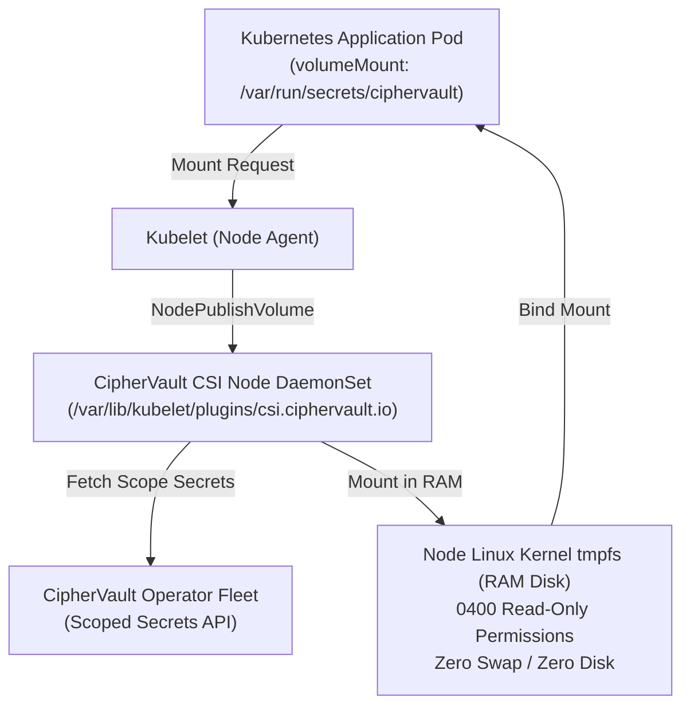

# CipherVault Kubernetes CSI Driver: Zero-Disk Ephemeral Secret Injection

The **CipherVault CSI Driver** (`csi.ciphervault.io`) mounts confidential application credentials and encrypted files directly into Kubernetes Pods as in-memory RAM volumes (`tmpfs`), guaranteeing that secrets are **never written to node host storage or recorded in cluster etcd**.

---

## Architecture Overview



---

## Key Security Guarantees

1. **Zero Disk Exposure:** All files are mounted exclusively in kernel `tmpfs` (RAM) with `nosuid`, `nodev`, and `noexec` flags.
2. **Restrictive Permissions:** Every materialized secret file receives `0400` read-only permissions owned by the target pod UID/GID.
3. **Zeroize on Pod Termination:** On `NodeUnpublishVolume`, file bytes are overwritten with zeroes before unmounting and directory removal.
4. **Scoped Revocation:** Pinned snapshot revisions and short-lived scope tokens ensure that pods only receive secrets within their explicit RBAC boundary.

---

## Deployment & Usage

### 1. Install CRD & DaemonSet
```bash
kubectl apply -f deploy/kubernetes/csi/crd/ciphervault_secret_crd.yaml
kubectl apply -f deploy/kubernetes/csi/driver/ciphervault-csi-driver.yaml
```

### 2. Configure a Pod with In-Memory Ephemeral Secret Mount
```yaml
apiVersion: v1
kind: Pod
metadata:
  name: billing-service
spec:
  containers:
    - name: app
      image: billing-service:v2
      volumeMounts:
        - name: vault-secrets
          mountPath: /var/run/secrets/ciphervault
          readOnly: true
  volumes:
    - name: vault-secrets
      csi:
        driver: csi.ciphervault.io
        readOnly: true
        volumeAttributes:
          project: "billing-system"
          environment: "production"
          revision: "latest"
          secrets: '{"DATABASE_URL": "postgres://...", "STRIPE_KEY": "sk_live_..."}'
```
