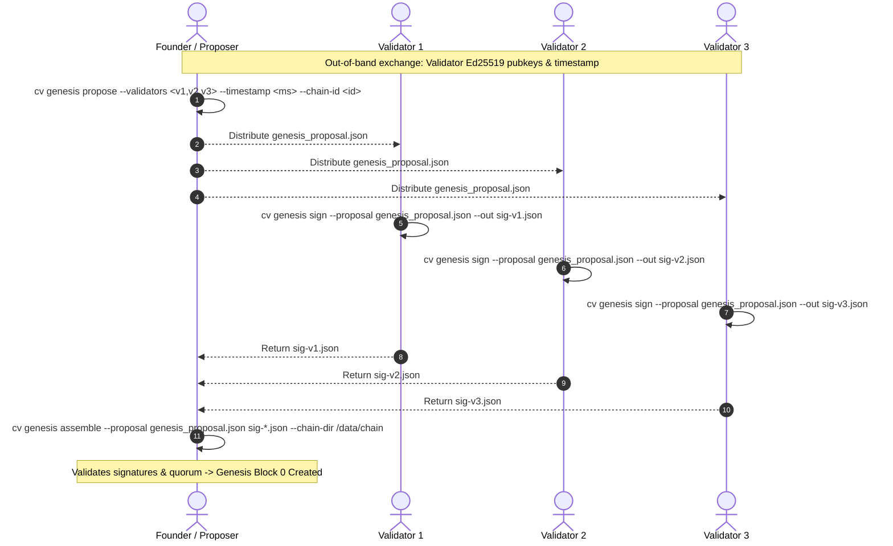

# CipherChain Genesis Ceremony & Validator Rotation Runbook

**Target:** Sovereign CipherChain (`crates/chain`, `apps/cli/src/commands/genesis.rs`)  
**Status:** Canonical operational guide for network bootstrapping and validator lifecycle.

---

## 1. Overview & Trust Architecture

CipherChain is an independent, zero-gas Proof-of-Authority (PoA) ledger designed to anchor cryptographic commitments and recovery head states without external L1/L2 dependencies.

Network bootstrapping requires a **Multi-Party Genesis Ceremony**:
- The initial validator set agrees out-of-band on parameters: `chain_id`, `timestamp_ms`, and validator public keys.
- **Proposer** generates a deterministic, unsigned height-0 block proposal (`proposal.json`).
- **Validators** review the terms and sign the proposal using their hardware-backed or locally persisted device signing key (`sig-<member>.json`).
- **Founder / Coordinator** collects signatures and runs assembly. Assembly validates each signature and confirms that the BFT quorum threshold is satisfied before initializing height 0 and writing the block ledger.
- **Late joiners & non-founding nodes** need no manual ceremony exchange: they discover the network over libp2p gossip, adopt the certified tip, and backfill historical blocks via the `GetChainBlocks` RPC.

---

## 2. Ceremony Roles & Parameters

| Parameter | Type / Format | Example / Default | Description |
|---|---|---|---|
| `chain_id` | String | `ciphervault-sovereign-1` | Unique chain identifier; domain-separates all signatures. |
| `validators` | Comma-separated 32-byte hex | `0x1111...1111,0x2222...2222,0x3333...3333` | Ed25519 public keys of founding validators. Automatically sorted and deduplicated. |
| `timestamp_ms` | Unix millis (u64) | `1731034800000` | Explicit agreed-upon Unix epoch millisecond timestamp for height 0. |
| Quorum rule | BFT $2N/3 + 1$ | $N=3 \to Q=3$, $N=4 \to Q=3$, $N=7 \to Q=5$ | Number of valid member signatures required to seal a block. |

---

## 3. Step-by-Step Genesis Ceremony Walkthrough



### Step 1: Founder Builds Deterministic Proposal

The founder collects all participant Ed25519 public keys and executes:

```bash
cv genesis propose \
  --validators "0x3a4f...11a0,0x7b2c...88ef,0x9c1d...44bc" \
  --timestamp 1731034800000 \
  --chain-id "ciphervault-sovereign-1" \
  --out genesis_proposal.json
```

**What this performs:**
* Parses, validates, deduplicates, and deterministically sorts member keys in lexicographical ascending order.
* Builds height-0 header with `EMPTY_TREE_ROOT` (`SHA-256("CIPHERVAULT_EMPTY_TREE_ROOT")`) for both `tx_root` and `state_root`.
* Sets `proposer = keys[0]`.
* Computes and prints the unsigned block hash:
  ```text
  Genesis proposal written to genesis_proposal.json
    Chain ID:      ciphervault-sovereign-1
    Members:       3 (quorum 3)
    Timestamp:     1731034800000
    Proposer:      0x3a4f...11a0
    Unsigned hash: 6f8a9e...3d2c
  ```
* Proposer shares `genesis_proposal.json` with all member operators out-of-band.

---

### Step 2: Members Inspect & Sign Proposal

Each member receives `genesis_proposal.json` and runs:

```bash
cv genesis sign \
  --proposal genesis_proposal.json \
  --out sig-member.json
```

**Security Checks Enforced at Signing:**
1. **Height check:** Fails if `header.height != 0`.
2. **Version check:** Fails if `header.version != PROTOCOL_VERSION`.
3. **No existing signatures:** Fails if `header.signatures` is not empty (must sign clean proposal).
4. **Strict Membership Enforced:** Loads the local node's device signing key (`~/.ciphervault/device.key` or DPAPI/OS keyring). If the local key is not explicitly listed in `file.validators`, signing **refuses with error**:
   ```text
   Error: local device key is not a member of this ceremony set
   ```
5. If valid, signs using domain separation tag `CIPHERVAULT_BLOCK_V1:` and outputs `sig-member.json`.
6. Member returns `sig-member.json` to the coordinator.

---

### Step 3: Quorum Assembly

Once signatures from a quorum of members are collected, the founder runs assembly:

```bash
cv genesis assemble \
  --proposal genesis_proposal.json \
  sig-v1.json sig-v2.json sig-v3.json \
  --chain-dir /var/lib/ciphervault/chain
```

**Assembly Invariants:**
* Destination `--chain-dir` must **not** already contain a `blocks/` directory (fail-closed against overwriting existing chains).
* Validates each signature against the block header and verifies that signers belong to the proposal validator set.
* Rejects assembly if `signatures.len() < quorum_threshold()`.
* Persists:
  * Block `000000000000.json` under `<chain-dir>/blocks/`.
  * `genesis_validators.json` holding the initial immutable founding set.
  * Initial `validators.json` configuring local operator admission.
* Prints canonical genesis hash:
  ```text
  Genesis assembled in /var/lib/ciphervault/chain
    Height:        0
    Members:       3 (quorum 3)
    Genesis hash:  9e74bc81...6a2d
  ```

---

## 4. Validator Set Rotation (Runtime Governance)

Validator sets are updated without chain restarts or hard forks via **Version 3 Rotation Blocks**.

### Rotation Lifecycle

1. **Proposal:** Proposer includes `next_validators: Some(Vec<[u8; 32]>)` in a block header.
2. **Voting:** Existing active validator set (Set A) signs and commits the block.
3. **Activation:** The instant the block commits at height $H$:
   * `ledger.validator_set()` updates to Set B.
   * Voting and quorum rules for height $H+1$ immediately require Set B signatures.
   * `validators.json` is updated on disk.
4. **Light Client Transition:** Light clients observing block $H$ verify Set A's quorum signatures over the rotation header, advance their trusted set to Set B, and verify height $H+1$ onwards using Set B.

### Partition & Quorum Loss Safeguards

* If rotation proposal lacks quorum from Set A, the block is rejected; chain remains on Set A.
* If Set B members fail to come online after block commit, chain halts safely without committing conflicting blocks (safety over liveness).
* Recovery from an offline or partitioned new validator set requires out-of-band intervention to reboot with a certified emergency checkpoint signed by the previous quorum.

---

## 5. Network Catch-Up for Late Joiners & Empty Replicas

Nodes joining after genesis do not perform manual ceremony operations:

1. **Discovery:** Connect to the libp2p swarm via configured bootstrap peers or rendezvous.
2. **Tip Adoption:** Observe `ChainSyncMsg::CertifiedBlock(tip)` gossiped across `services/operator::swarm`.
3. **Backfill Protocol:**
   * Node queries peer using `GetChainBlocks { start_height, limit: 256 }`.
   * Verifies RFC-6962 hash chaining and state roots backwards from tip down to the genesis hash.
   * Once backfill links to genesis, node adopts active validator set and begins participating in quorum.
