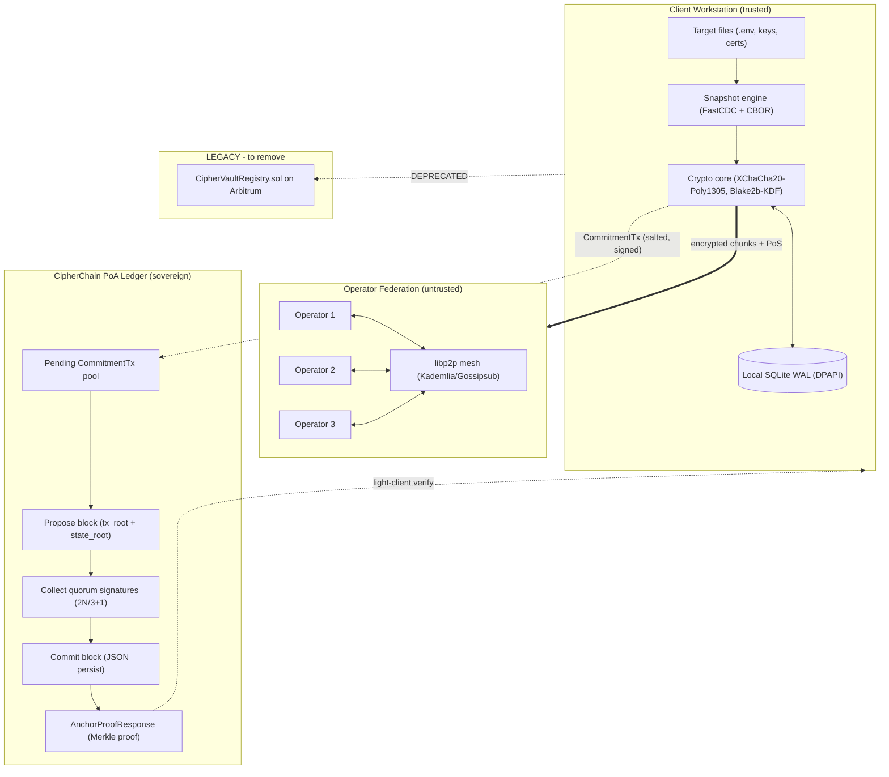

# CipherVault Ledger / Blockchain — Full Audit & Sovereign-Chain Migration Analysis

**Date:** 2026-11-07
**Scope:** `crates/chain` (CipherChain sovereign ledger), `crates/storage/src/chain.rs` (Arbitrum anchor client), `contracts/CipherVaultRegistry.sol`, `apps/cli/src/commands/anchor.rs`, `foundry.toml`, docs referencing settlement
**Version audited:** v1.0.29 (`cargo test -p ciphervault-chain`: 5/5 passing)
**Decision under review:** Drop Ethereum/Arbitrum entirely → sovereign CipherChain only, with encrypted records
**Companion diagram:** `report/CIPHERVAULT_SOVEREIGN_CHAIN_ARCHITECTURE.html` (open in any browser, offline)

---

## 1. Executive summary

1. **The sovereign chain already exists.** `crates/chain` (`ciphervault-chain`) is a working zero-gas Proof-of-Authority ledger: Ed25519 validator quorum, salted commitments `SHA-256("CIPHERVAULT-ANCHOR-V1" || salt || head_cid)`, dual Merkle roots (`tx_root` + cumulative `state_root`), JSON file persistence, and a light client. The `lib.rs` header explicitly states it *"eliminates reliance on external L1/L2 blockchains (such as Arbitrum or Ethereum)"*.
2. **But the Ethereum/Arbitrum path is NOT gone.** It is still fully wired as a fallback: `crates/storage/src/chain.rs` (1,136 lines, `ArbitrumAnchorClient`), `contracts/CipherVaultRegistry.sol`, `foundry.toml` (Arbitrum Sepolia/One RPC + Arbiscan), and a dual-path `cmd_anchor` (953 lines) that takes the Arbitrum route whenever `--rpc`, `--contract`, `--tx-hash`, `--raw-tx`, `--relayer-url`, or env vars (`CIPHERVAULT_REGISTRY_CONTRACT`, `ARBITRUM_RPC_URL`, `ARBITRUM_CONTRACT_ADDRESS`) are present.
3. **Your request is therefore a removal + hardening task, not a from-scratch build.** The correct move per your directive ("no Ethereum, own chain, records encrypted and stored") is: (a) delete/archive the Arbitrum stack, (b) fix the one critical gap that makes today's sovereign path single-node theater (see §5.1), (c) wire the ledger to the existing libp2p operator federation so quorum is real, and (d) keep bulk encrypted bytes OFF the chain (operators) while putting opaque commitments — and optionally small encrypted envelopes — ON the chain.
4. **"Recorded encrypted and stored" needs one scoping decision from you** (§7): today the chain stores only 32-byte opaque commitments (privacy-preserving by design, nothing to decrypt). If you literally want encrypted record payloads recoverable from the chain itself, add a new optional `EncryptedEnvelopeTx` type (small metadata only, XChaCha20-Poly1305). Do NOT put file chunks on-chain — that recreates every cost problem Ethereum gave you.

**Recommended verdict: Approve sovereign-only direction. Do the removal (§8, Phase 1) + the 3 hardening fixes (§8, Phase 2) before adding any new features.**

---

## 2. What exists today — file inventory

| Layer | Files | Size | Role |
|---|---|---|---|
| Sovereign ledger | `crates/chain/src/{lib,types,consensus,ledger,light_client,merkle,error}.rs` | ~1,260 lines total | PoA chain: genesis, propose, quorum-verify, commit, Merkle proofs, light-client verify |
| Sovereign tests | `crates/chain/tests/sovereign_tests.rs` | 209 lines | Full lifecycle + BFT rejection test (both passing) |
| Legacy EVM anchor | `crates/storage/src/chain.rs` | 1,136 lines | `ArbitrumAnchorClient`: `eth_blockNumber`, `eth_call`, receipt fetch, `publish(bytes32)` / `getFirstSeenBlock(bytes32)` calldata, finality staging |
| Legacy contract | `contracts/CipherVaultRegistry.sol` + `test/` + `script/` | 43 lines contract | `publish(bytes32)` / `firstSeenBlock` map / `CommitmentPublished` event; non-custodial, stores zero plaintext |
| Legacy toolchain | `foundry.toml` | 19 lines | solc 0.8.24, cancun, Arbitrum Sepolia + One RPC/Arbiscan |
| CLI dual-path | `apps/cli/src/commands/anchor.rs` | 953 lines | Sovereign default; Arbitrum when flags/env force it (`explicit_arbitrum` gate, lines 46–55) |
| Dashboard/TUI | `apps/cli/src/dashboard/finality.rs`, `tui/{app,ui}.rs` | — | Still renders Arbitrum finality stages |
| Docs | `docs/SYSTEM_WORKFLOW.md`, `DECENTRALIZED_ARCHITECTURE_SPEC.md`, `MAINNET_ANCHOR_PROMOTION.md`, etc. | — | Still describe "Arbitrum L2 Rollup / CipherVaultRegistry.sol / Sequencer Anchoring" as the settlement layer — **stale** |
| P2P (unused by chain) | `services/operator::swarm` (libp2p 0.57: QUIC+TCP, Noise, Yamux, Kademlia, Gossipsub, mDNS, relay, DCUtR, AutoNAT, rendezvous) | — | Mesh exists for storage; chain block propagation is NOT wired to it yet |

Chain constants (ground truth, `crates/chain/src/types.rs`):

- `SOVEREIGN_CHAIN_ID_NUM = 777777`, `SOVEREIGN_CHAIN_ID_STR = "ciphervault-sovereign-1"`, `PROTOCOL_VERSION = 1`
- `BLOCK_SIGNING_DOMAIN = "CIPHERVAULT_BLOCK_V1:"`, `TX_SIGNING_DOMAIN = "CIPHERVAULT_TX_V1:"`
- Commitment derivation: `SHA-256("CIPHERVAULT-ANCHOR-V1" || salt || head_cid)` (note: light-client comment says `SHA-256(salt || head_cid)` — same function, loose comment, fix wording)
- Merkle: RFC-6962 style, `0x00` leaf / `0x01` node prefixes, odd-leaf duplication, `EMPTY_TREE_ROOT = SHA-256("CIPHERVAULT_EMPTY_TREE_ROOT")`

---

## 3. System architecture (sovereign target + legacy to remove)

Full interactive diagram: open `report/CIPHERVAULT_SOVEREIGN_CHAIN_ARCHITECTURE.html` in a browser.
Markdown summary below (also mirrored as Mermaid in §3.2).

### 3.1 Structure — component map

```text
┌─ CLIENT WORKSTATION (trusted) ─────────────────────────────┐
│ CLI / TUI / Agent / Dashboard (apps/cli, apps/agent)       │
│  ├─ Snapshot engine (FastCDC 4–64 KiB, CBOR manifests)     │
│  ├─ Crypto core (XChaCha20-Poly1305, Blake2b-KDF, Ed25519, │
│  │   X25519, Shamir GF(2^8), Zeroize)                      │
│  ├─ Local store (SQLite WAL + DPAPI/OS keyring)            │
│  └─ Sovereign light client (verify proofs offline)         │
└──────────────────────────┬─────────────────────────────────┘
                           │ encrypted chunks + PoS (opaque CIDs)
┌─ OPERATOR FEDERATION (untrusted, untrusted headers only) ──┐
│  Op1 :8201  Op2 :8202  Op3 :8203  (+ libp2p mesh: Kademlia │
│  DHT / Gossipsub / Noise / Yamux / QUIC+TCP / mDNS)        │
│  ├─ Encrypted blob store (chunks, manifests, envelopes)   │
│  ├─ PoS challenge + maintenance self-repair daemon        │
│  └─ ★ CIPHERCHAIN VALIDATORS (missing wire-up — §5.1) ★   │
└──────────────────────────┬─────────────────────────────────┘
                           │ CommitmentTx (vault_id, salt,
                           │ head_cid, commitment, sig, nonce)
┌─ CIPHERCHAIN PoA LEDGER (sovereign, zero-gas) ─────────────┐
│  SovereignLedger: genesis → propose → quorum (2N/3+1) →   │
│  commit → blocks/NNNNNNNNNNNN.json → tx_root + state_root │
│  AnchorProofResponse { height, block_hash, tx_proof,       │
│  header, sig count } → light-client verify                 │
└────────────────────────────────────────────────────────────┘
┌─ LEGACY — TO DELETE (§8 Phase 1) ─────────────────────────┐
│  ArbitrumAnchorClient → RPC → CipherVaultRegistry.sol     │
│  `publish(bytes32)` on Arbitrum One/Sepolia + Arbiscan     │
│  + foundry.toml + finality dashboard stages               │
└────────────────────────────────────────────────────────────┘
```

Key separation to preserve: **bulk encrypted bytes live on operators (content-addressed by CID); the chain stores only 32-byte opaque commitments + Merkle roots + quorum signatures.** That is what makes the ledger tiny, zero-gas, and privacy-safe. Operators see equality/sizes/counts — never plaintext.

### 3.2 Workflow diagram (Mermaid)



---

## 4. System workflow — end to end (as built)

### 4.1 Normal sovereign anchor (`cmd_anchor`, no Arbitrum flags)

1. **Resolve head.** `--head <hex>` or `store.get_active_head()` → 32-byte `head_cid` (snapshot ID). Fail closed if none.
2. **Salt + commitment.** Reuse pending `CheckpointEvidence` salt/commitment if present, else `rand::thread_rng().fill_bytes(salt)` + `commitment = SHA-256("CIPHERVAULT-ANCHOR-V1" || salt || head_cid)`. Salt stays client-side; commitment is opaque.
3. **Sign tx.** Fresh `ConsensusSigner::generate()` → `CommitmentTx { vault_id, salt, head_cid, commitment, client_pubkey, signature, nonce, timestamp_ms }`, `sign_tx(chain_id)`. ⚠️ See §5.1 — fresh key per anchor means no stable client identity.
4. **Open-or-genesis ledger.** `~/.ciphervault/chain/blocks/` exists → `SovereignLedger::open(...)` (re-verifies every block); else `create_genesis(...)` with a fresh single operator signer.
5. **Propose.** `propose_block(proposer, txs, ts)`: checks proposer ∈ set, `ts` monotonic, `tx.verify_signature()` each, builds `tx_root` (Merkle over `tx_leaf_hash`) and prospective cumulative `state_root` (Merkle over all `hash_leaf(commitment)` ever), proposer self-signs.
6. **Commit.** `commit_block`: re-checks height sequence, `prev_block_hash`, monotonic ts, per-tx signatures, recomputes both roots, `verify_header_signatures` (quorum), persists `blocks/{height:012}.json` pretty-printed, appends to in-memory indexes (`commitments_index`, `cid_to_commitment`, cumulative tree).
7. **Evidence.** Writes `CheckpointEvidence` (salt, commitment, block height/hash) to local store for later verify/recover.
8. **Prove / verify (reader side).** `get_proof_for_commitment` / `get_proof_for_head_cid` → `AnchorProofResponse { tx_proof: InclusionProof }`. `SovereignLightClient::verify_anchor` checks: chain-id match → CID/salt match → recompute commitment → recompute block hash → height match → `tx_proof.verify(tx_root)` → count valid Ed25519 sigs from trusted set ≥ quorum.

### 4.2 Legacy Arbitrum anchor (deprecated path, same CLI)

`encode publish(bytes32)` calldata → relayer or direct RPC `eth_sendRawTransaction` → poll `eth_getTransactionReceipt` → require receipt `status==1`, `to == registry`, logs contain `COMMITMENT_PUBLISHED_TOPIC` for that commitment → `eth_call getFirstSeenBlock` → finality stage machine (`Pending → SequencerConfirmed → L2Confirmed(64+) → DeeplyConfirmed(50400+)`), with the honest caveat in code comments that L2 confirmations are NOT L1 finality and no fraud-window is verified. Costs gas, needs RPC provider (Alchemy/Infura-style dependency), needs payer wallet/relayer, leaks timing metadata to a public mempool/L2.

### 4.3 Recovery workflow (unchanged by settlement choice)

Paper kit (`R`) or Shamir shares → rebuild epoch keys → pull encrypted chunks from operators → decrypt + CBOR-restore → optionally re-verify head against CipherChain proof (offline-capable via light client + trusted validator keys).

---

## 5. Audit findings

### 5.1 Critical — fix before calling this "decentralized"

| # | Finding | Location | Impact | Fix |
|---|---|---|---|---|
| C1 | **Single-use throwaway identities: every anchor generates a fresh client signer AND a fresh single operator signer**; validator set is `[op_signer]` with quorum 1 | `anchor.rs:106-137` | Local chain is self-attested. No BFT, no federation, no continuity. A copied `chain/` dir is the only "consensus". | Persistent operator keystore (`~/.ciphervault/operator_key`), persistent client device key, multi-operator validator set config; never `generate()` on the hot path |
| C2 | **No block propagation.** libp2p swarm exists but `crates/chain` has no networking: no gossip, no mempool sync, no fork choice, no peer catch-up | `crates/chain/*`, `services/operator::swarm` | N operators each grow incompatible local forks the moment N>1 | Wire `propose/commit` to gossipsub + request-response catch-up (deps already in `Cargo.toml`); define fork rule (highest quorum-certified height wins; equivocation evidence) |
| C3 | **Nonce = wall-clock millis, no replay store.** Two anchors in the same ms collide; a captured tx re-submitted in a later block re-verifies (commitment is idempotent by design, but vault accounting is not) | `types.rs:148-158`, `anchor.rs:114` | Replay / double-anchor ambiguity; `commitments_index.insert` silently overwrites prior record for same commitment | Monotonic per-`client_pubkey` nonce table persisted in ledger + reject `nonce <= last_seen`; or treat re-anchor as explicit re-attestation tx type |

### 5.2 High — privacy / integrity gaps in the "encrypted + stored" promise

| # | Finding | Detail | Fix |
|---|---|---|---|
| H1 | Chain stores commitments, NOT encrypted records. If your requirement is "records themselves live on-chain encrypted", that feature does not exist yet | Current `CommitmentTx` has no payload/ciphertext field | Add optional `EncryptedEnvelopeTx` (see §7) for small records only; keep chunks on operators |
| H2 | `vault_id` is stored in cleartext in every tx and every `CommitmentRecord` | Correlation across anchors for the same vault | Hash or encrypt `vault_id` (e.g. store `SHA-256("VAULT" \|\| vault_id)` or ECIES to auditor key); needs migration |
| H3 | No chain pruning / snapshot policy; `blocks/*.json` pretty-printed forever; cumulative Merkle rebuilt from scratch per block (`O(n)` clone in `propose` + `commit`) | Fine at hundreds of anchors; degrades past ~10k | Compact snapshots every K blocks + `state_root` checkpoints; switch persistence to canonical CBOR + fsync; incremental Merkle frontier |
| H4 | Timestamp is proposer-asserted wall clock with only monotonicity check | Operator can drift/backdate within monotonic bound | Median-of-quorum timestamp rule + max-skew reject (e.g. ±5 min vs local clock at commit) |

### 5.3 Medium — correctness / robustness

- **M1. Comment/code drift:** `light_client.rs` says `SHA-256(salt \|\| head_cid)`; code is `SHA-256("CIPHERVAULT-ANCHOR-V1" \|\| salt \|\| head_cid)`. Fix the comment.
- **M2. Quorum edge:** `N<=2 → quorum = N` (unanimity for 2 validators). Document as intentional; for 3 validators quorum is correctly 3 (test asserts it).
- **M3. Persistence fragility:** `open()` sorts filenames lexicographically (works with `%012d` only); no checksum per file beyond re-verification; no atomic write (crash mid-write → torn JSON). Use write-tmp + rename + per-file SHA-256 sidecar.
- **M4. `get_proof_for_head_cid` keeps only the LATEST commitment per CID** (`cid_to_commitment` overwrite). Re-anchors of the same head lose history. Return a vector or keep first-seen + history list.
- **M5. Arbitrum receipt caveat is honest but dashboard may overstate finality** (`DeeplyConfirmed` ≠ settlement). Deleting the path resolves it; until then relabel UI strings.
- **M6. Pretty JSON + hex signatures bloat proofs** (`AnchorProofResponse` embeds full header + every signature). Fine now; add compact proof encoding when proofs go over the wire via P2P.

### 5.4 What is genuinely good (keep)

- Domain-separated signing bytes, strict Ed25519 (`verify_strict`), duplicate-signature + unauthorized-signer + proposer-membership checks, both-roots verification on commit AND on open (full replay), Merkle domain separation, idempotent contract design, honest finality comments, 5/5 tests green including a BFT-rejection case.

---

## 6. Ethereum/Arbitrum removal — exact cut list

**Delete / archive:**
`contracts/` (all `.sol`, `test/`, `script/`), `foundry.toml`, `crates/storage/src/chain.rs` (`ArbitrumAnchorClient` + receipt types), the `explicit_arbitrum` branch in `anchor.rs` (~700 of its 953 lines), `dashboard/finality.rs` Arbitrum stages, TUI finality widgets, `.agents/plans/2026-09-24-arbitrum-activation.md` (archive), Arbitrum references in `dist/config/ciphervault.toml`, `docs/` settlement sections, `apps/cli/tests/chain_anchoring.rs` Arbitrum cases (keep sovereign ones), `Cargo` deps that become unused (`reqwest` in storage? `sha3`/Keccak only used for selectors — verify then drop).

**Keep:** `CheckpointEvidence::{salt, commitment}` fields (chain-agnostic), `contracts/` git history (tag `last-evm-anchor` before deletion for auditors), the `COMMITMENT_PUBLISHED_TOPIC` constant documented in the migration note (for anyone verifying old anchors).

**Docs to rewrite:** `SYSTEM_WORKFLOW.md` §1 axiom 5 + §2 table ("Arbitrum Registry" → "CipherChain PoA ledger"), `docs/diagrams/01_system_architecture.svg`, `README.md` settlement paragraph, `DECENTRALIZED_ARCHITECTURE_SPEC.md`, `MAINNET_ANCHOR_PROMOTION*.md` (mark superseded).

---

## 7. "Recorded encrypted and stored" — design decision for your review

Two readings, pick one (recommendation: **A**, with B as opt-in):

**Option A (recommended, minimal change): commitments on-chain, encrypted bytes on operators.**
Nothing new to encrypt on the ledger — the 32-byte commitment IS the privacy mechanism (random salt, no plaintext, no CID). Bulk data stays as XChaCha20-Poly1305 chunks on operators. Chain stays tiny and fast. This already satisfies "nothing readable on-chain" in the strongest sense.

**Option B (only if you need chain-resident recoverable records): add `EncryptedEnvelopeTx`.**

```rust
pub struct EncryptedEnvelopeTx {
    pub vault_ref: [u8; 32],   // blinded vault ref, NOT raw vault_id (fixes H2)
    pub nonce24: [u8; 24],     // XChaCha nonce
    pub ciphertext: Vec<u8>,   // ≤ 2 KiB: e.g. head-record fields, rotation notice
    pub key_hint: [u8; 8],     // epoch/key id, no key material
    pub client_pubkey: [u8; 32],
    pub signature: [u8; 64],   // over all above + chain_id + nonce
    pub nonce: u64,             // replay-protecting counter (fixes C3)
}
```

Rules: max size enforced at `propose_block`; decryption only client-side with epoch key; operators/validators see ciphertext only; bulk chunks NEVER use this type. Cost: chain grows with envelopes → needs §5 H3 pruning.

**Do not do:** plaintext metadata on-chain, ставить whole snapshots on-chain, or per-chunk txs (state explosion, kills the zero-gas story).

---

## 8. Recommended plan (phased, for your approval)

**Phase 1 — Cut EVM (1–2 days).** Execute §6 cut list; make `cmd_anchor` sovereign-only; delete dashboard finality stages; rewrite stale docs; tag `last-evm-anchor`; `cargo test` + `cargo clippy` green. No behavior change to sovereign path.

**Phase 2 — Make quorum real (1–2 weeks, the actual decentralization).** Persistent operator + device keys (C1); per-pubkey nonce table (C3); gossipsub block proposal + quorum-cert aggregation + request-response catch-up (C2); median timestamps (H4); blinded `vault_ref` (H2); atomic JSON writes (M3). Acceptance: 3 local operators, kill -9 one mid-anchor, proof still verifies with 2/3 quorum.

**Phase 3 — Encrypted records (only if you pick §7-B).** `EncryptedEnvelopeTx` + size cap + light-client support + pruning/snapshot policy (H3). Acceptance: envelope anchors, verifies offline, chain size stays bounded.

**Phase 4 — Operability.** Validator membership-change txs + rotation ceremony docs; metrics (`height`, `quorum_latency`, `proof_size`); proof export/import (`anchor export-proof/verify-proof`); dashboard rewrite against sovereign heights instead of L2 blocks.

---

## 9. Suggested new features (ranked, beyond the cut)

1. **Validator rotation / membership txs** — without this the federation can never change; highest priority after Phase 2.
2. **Equivocation evidence + fork-choice rule** — two quorum certs at same height from same validator → slash/evict; required the moment blocks travel the network.
3. **`cv anchor verify --offline` with pinned validator set** — air-gapped recovery verification; cheap, high trust value.
4. **Checkpoint snapshots + fast sync** — new operator bootstraps from snapshot + quorum cert, not full replay.
5. **Encrypted envelope records (§7-B)** — only if business needs chain-resident data.
6. **Multi-vault batch anchor** — one block, many commitments, amortized quorum cost (trivial given current `Vec<CommitmentTx>` design).
7. **Auditor read-only watch key** — ECIES-wrapped commitment log for compliance without exposing salts.
8. **Prometheus/OpenMetrics for chain height, quorum latency, fork count** — operator necessity.

Explicitly NOT recommended: EVM re-anchoring ("checkpoint to Arbitrum" bridges reintroduce gas, RPC trust, and wallet custody for zero audit benefit now that quorum + Merkle roots are self-contained); PoW/PoS token mechanics (no token needed for a permissioned backup ledger); putting chunks on-chain.

---

## 10. Open questions for your review (reply and I proceed)

1. **§7: A or B?** Commitments-only (A) or add small encrypted envelopes on-chain (B)?
2. **Validator set:** who are the first 3–5 operators, and who holds their keys (local keystore vs YubiKey PIV Slot 9C)?
3. **Blinded vault ref:** OK to migrate `vault_id` → hashed ref (breaks old proof queries by raw id; migration shim provided)?
4. **Phase 1 cut approval:** may I delete `contracts/`, `foundry.toml`, and the Arbitrum branch of `anchor.rs` (tagged first)?
5. **Network binding:** should Phase-2 block gossip reuse the existing libp2p swarm (port range `:8201-8203`), or a dedicated chain port?

---

## Appendix — verification evidence

- `cargo test -p ciphervault-chain` → 3 unit + 2 integration tests pass (Merkle empty/single/multi + full lifecycle + BFT rejection), 2026-11-07.
- File sizes re-verified this session: `crates/storage/src/chain.rs` 1,136 lines; `anchor.rs` 953 lines; `contracts/CipherVaultRegistry.sol` 43 lines; `crates/chain/src/*` ~1,260 lines.
- Git state at audit time: branch `main`, 3 modified TUI files (`apps/cli/src/tui/{app,events,ui}.rs`) + `docs/CLI_TUI_AUDIT_REPORT.md` — untouched by this report; no commits made.
- Pre-existing risk note: `docs/SYSTEM_WORKFLOW.md` still specifies Arbitrum settlement (v1.0.17-era text) while code defaults to sovereign — docs lag code; Phase 1 reconciles them.

*End of original report. Phase 1 executed 2026-11-07 — log follows.*

---

## Phase 1 completion log (2026-11-07, EVM removal executed)

**Tag:** `last-evm-anchor` created before deletion (legacy EVM history preserved).

**Deleted:** `contracts/` (all `.sol`, `test/`, `script/`), `foundry.toml`, `crates/storage/src/chain.rs` EVM stack (`ArbitrumAnchorClient`, `AnchorRelayerClient`, receipt/finality types, all EVM tests; sovereign `SovereignAnchorClient`/`SovereignAnchorReport` kept), EVM branch of `cmd_anchor`/`cmd_verify_anchor` + their mock-RPC tests, `services/operator` relayer routes/handlers/state/persistence/tests, `apps/cli/tests/chain_anchoring.rs` EVM cases (rewritten as sovereign round-trip + proof tests), `chaos_federation_drill` relayer step (now plain `anchor`).

**Simplified to sovereign-only:** CLI flags (`anchor`: `--head/--daemon/--interval`; `verify-anchor`: `--head`), `dashboard/finality.rs` (plain publisher-signed feed; EVM receipt enrichment, reorg memory, and RPC helpers removed), dashboard metrics HELP strings, `dist/config/ciphervault.toml` `[chain]`, GCP deploy env, README/CONTRIBUTING/SYSTEM_WORKFLOW/DASHBOARD_API_REFERENCE/DECENTRALIZED_ARCHITECTURE_SPEC/MAINNET_*/diagram, UI + landing anchor labels (donation addresses untouched).

**Verified:** `cargo check --workspace --all-targets` clean; `cargo test` green across storage, chain, operator, CLI (incl. rewritten sovereign tests + chaos drill), and all remaining crates; UI `audit.test.cjs` passes; `node --check` on landing script passes.

**Deliberately left for follow-up:** TUI doc-comments mentioning Arbitrum cost (user has uncommitted TUI work in flight); `apps/ui` chain-label fallbacks for 42161/421614 (harmless display mapping for old evidence); operator `relayed-checkpoints.json` files on existing disks (code no longer reads them); `CIPHERVAULT_FINALITY_CONFIRMATIONS` deploy plumbing (no reader; inert).

**Next (awaiting approval):** Phase 2 — persistent operator/device keys, per-pubkey nonce table, gossipsub block propagation + quorum-cert aggregation, median timestamps, blinded vault refs.

---

## Phase 2 progress log — items 1–2 done (persistent keys + nonces)

**1. Persistent device key.** `ConsensusSigner::load_or_create(path)` (`crates/chain/src/consensus.rs`): reads a 32-byte seed file or generates + stores one (0600 on Unix); corrupt files are rejected, never overwritten. `anchor`/`verify-anchor` share `load_device_and_validators()`: one persistent `chain/device.key`, one explicit `chain/validators.json` (solo bootstrapped from the device key; fleets edit the file to add members). No more per-run throwaway keys.

**2. Per-pubkey nonce table.** `SovereignLedger` tracks last committed nonce per client key (`crates/chain/src/ledger.rs`), enforced in both `propose_block` and `commit_block_internal` via `CommitmentTx::check_nonce` (new `ChainError::StaleNonce`). Table is derived state — rebuilt on `open()` replay, no sidecar. `anchor` uses `ledger.next_nonce()` instead of wall-clock. Pre-Phase-2 local chains (throwaway genesis keys) fail to verify under the persistent set: they are renamed to `chain.pre-phase2-<millis>` (never deleted) and replaced with a fresh genesis, with a notice.

**Verified:** 3 new chain tests (key roundtrip + corrupt rejection, replay/lower-nonce rejection + advance, reopen persistence) — 8/8 chain tests green; `chain_anchoring` + chaos drill green; storage suite green; `cargo check`, clippy (no new warnings), and `cargo fmt --check` clean on touched files.

**Still open (items 3–4):** gossipsub block propagation + quorum-cert aggregation across nodes; median timestamps.

---

## Phase 2 progress log — item 3 core done (consensus wire protocol + vote aggregation)

**New module `crates/chain/src/sync.rs` (transport-agnostic).** JSON `ChainSyncEnvelope`s
(sealed with the validator device key, domain `CIPHERVAULT_SYNC_V1:`, topic
`ciphervault/chain/1`) carry three messages: `Proposal` (full block, proposer
endorsement only), `Vote` (header + endorsement, no relaying), `CertifiedBlock`
(full quorum block for catch-up). `ChainSyncHub::ingest(bytes)` is the single
transport seam: admission checks membership + signature + chain, then routes.

**Quorum-cert aggregation.** `VoteCollector` accumulates endorsements keyed by
(proposal hash); `ChainSyncHub` assembles certificates once 2N/3+1 is reached
and commits. Certificate signatures are sorted by validator so every honest hub
assembles the identical block. Replays read as `Duplicate`/`Stale`, conflicting
certified blocks as `ForkRejected`, unknown senders/tampered bytes/wrong chain
as `Rejected`, double-votes as `EquivocationDetected` (evidence retained).

**Ledger support.** `commit_block_internal` split into pure `check_block`
(structure/linkage/txs/nonces/roots, used to vet remote proposals) + quorum +
apply; new `ValidatorSet::verify_proposer_signature` (pre-quorum endorsement
check), `block_at_height`, `ConsensusSigner::sign_raw` /
`verify_raw_signature`, `ChainError::ForkDetected`.

**Verified:** 5 new in-process multi-node tests (3-node round → identical
committed blocks on all hubs; vote-before-proposal; equivocation; fork
rejection + certified catch-up; hostile inputs) — 13/13 chain tests green;
`chain_anchoring` + storage suites green; workspace check, clippy, and
`cargo fmt` clean.

**Explicitly next (transport slice):** subscribe `ciphervault/chain/1` in the
operator swarm, map Strict-validation verdicts onto `IngestOutcome`, add
`GetBlocks` catch-up RPC, and wire `anchor` proposal publication — all call
`hub.ingest` and need no consensus changes. *(Done 2026-11-07 — see log below;
`GetBlocks` + CLI publication remain.)*

---

## Phase 2 progress log — transport slice done (gossip admission + live tests)

**Operator swarm carries chain envelopes.** `ciphervault/chain/1` subscribed at
boot (`behaviour.rs`); `SwarmHandle::publish_chain` +
`Command::PublishChain` mirror the control path with the same 64 KiB cap;
inbound gossip is routed by topic hash to the new `accept_chain_message`
gate: parse → validator-set membership → device-key signature → sovereign
chain match. Accept relays well-formed fleet messages, Reject penalizes
forgeries/non-members, Ignore passes over wrong-chain payloads and the
unset-validator case. Per-node `ChainStats { accepted, rejected, ignored }`
via `Command::ChainStats`. Deliberately no commits in the event loop —
consensus stays in `ChainSyncHub` (next: hub attachment + `GetBlocks`
catch-up + CLI publication).

**Verified:** new `swarm_chain.rs` live two-swarm suite (3 tests: vote +
proposal propagate and admit; tampered/outsider rejected, wrong-chain and
disabled ignored; 70 KiB publish refused) — all green, twice in a row;
operator check/clippy/fmt clean; full operator suite running.

**Item 4 done — validator-voted median timestamps (protocol v2).**
Committed block time is now the quorum median of voter-observed times,
not the proposer's stamp. `PROTOCOL_VERSION` bumped to 2 with a
version gate: v1 blocks (timestamp inside the signed bytes) keep
verifying byte-for-byte; v2 signatures cover everything EXCEPT the
timestamp, votes carry `observed_ms`, assembly substitutes the median,
and `block_hash` commits to it. Voter rules documented on `VoteMsg`:
endorse only within 60s skew (`proposal_time_acceptable`), clamp
observations past the parent (`vote_observed_ms`). Solo CLI path
unchanged in behavior (median of one = own time) via version-aware
sign/verify. No operator/CLI changes needed beyond the shared rule.

**Verified:** 3 new chain tests (median replaces suggestion 9000→4000
with identical hashes on all hubs; v1 round keeps proposer time;
median/skew/clamp helpers) — 18/18 chain green; `swarm_chain` (4/4),
`chain_publish` (2/2), `chain_anchoring` (2/2), CLI anchor unit tests
(3/3) green; workspace check clean; fmt clean; clippy clean except the
pre-existing `tui/app.rs` warning (untouched, user's in-flight work);
full operator suite green (all binaries, 0 failures).
**Encrypted-blob salt custody (uncommitted).** The commitments-only gap
is closed at the salt: anchor salts are now derived from the snapshot's
epoch key (`Blake2b CipherVault-KDF-v1 | CV_ANCHR | epoch_key |
head_cid`), so the owner re-derives them from replicated recovery
records after local state loss — no new network calls, deterministic
across push retries, opaque to everyone else. Legacy heads (unknown
snapshot, pre-existing evidence) keep their old salts with a warning.
`LocalVaultStore::derive_head_anchor_salt` + `VaultEpochKey::
derive_anchor_salt` + `kdf::derive_anchor_salt`.

**Verified:** new KDF test (determinism, head/epoch binding, domain
separation) and db round-trip test (derived == independent KDF,
unknown head errors); crypto 39, local-store 30, CLI anchor/anchoring
suites green; workspace check/fmt clean; clippy clean except the
pre-existing `tui/app.rs` warning (yours, untouched). One real catch
fixed along the way: a closure capturing `&store` made `cmd_anchor`'s
future `!Send` (store is `RefCell`-backed) and broke the dashboard
handlers — replaced with a free function.

**Rotation + ceremony (uncommitted).** Validator sets rotate in-band:
`header.next_validators` (v3, `#[serde(default)]` so old blocks load as
`None`) is quorum-certified by the current set and takes effect for the
next height on commit; replay derives every later set from a
`genesis_validators.json` trust anchor (legacy dirs fall back to the
configured set). `SovereignLedger::open/rebuild` verify block 0 against
the genesis record; hubs re-key their vote collectors on every commit;
operators sync admission to the chain (file is seed/intent, chain is
truth); catch-up serves the genesis set with height-0 chunks and the
backfiller verifies block 0 against it (linkage to the trusted adopted
tip authenticates the rest). Light clients advance explicitly via
`advance_to_rotation`. CLI: `anchor --rotate-to` (one-shot, daemon ticks
stay rotation-free) + `genesis propose/sign/assemble` file ceremony with
deterministic sorted sets; failed quorum fails closed.

**Verified:** 3 rotation tests (re-keyed voting round, malformed
payloads, reopen lands on rotated set under old or new seed), light
client advance test, ceremony propose-determinism + assemble quorum
round-trip (2-of-3 fails, 3-of-3 persists and reopens); chain 23/23,
CLI bin 231/231, anchoring suites green; workspace check/fmt clean;
clippy clean except the pre-existing `tui/app.rs` warning (yours, plus
one required line: the `cmd_anchor` signature change); full operator
suite green (all binaries, 0 failures).

---

## Phase 2 progress log — hub attachment + catch-up done

**Operator-hosted hub replica.** `OperatorState::chain_sync` holds the fleet
validator set + `ChainSyncHub`. `SetChainValidators` opens `data_dir/chain`
when present (complete unless `tip.json` lingers) and otherwise arms adoption
of the first certified tip. Inbound gossip now feeds `ingest_chain_msg`:
proposals/votes aggregate toward quorum commits; certified tips bootstrap
empty replicas; forks reject; `NeedCatchup` triggers backfill.

**Catch-up loop.** New P2P-only `GetChainBlocks{from,limit}` RPC (bounded,
unauthenticated public data like gossip) served from the hub replica.
`NeedCatchup` — or any incomplete hub that sees traffic — starts a
single-flight sequential fetch (0..=tip, 256-block chunks, contiguity-checked);
completion calls `hub.backfill`, which rebuilds genesis-anchored history with
full validation, persists it, and clears the tip snapshot. Failures drop the
fetch and retry on the next trigger; hub-less nodes relay well-formed traffic
instead of rejecting it.

**Chain-crate support.** `from_certified_tip` (quorum + tx-sig verified tip
adoption with tip snapshot), `rebuild_from_blocks` (full revalidation +
persist, clears the snapshot), tip-aware `open()` (resumes from `tip.json`),
`hub.adopt_tip` / `hub.backfill` / `is_complete` gating (incomplete hubs
collect votes but never assemble), `check_block` extraction reused by
proposals.

**Verified:** 3 new chain tests (adopt→refuse→backfill→commit round;
gap/wrong-chain backfill rejection; tip snapshot resume + rebuild persist) —
16/16 chain tests green; 1 new live two-swarm backfill test (empty node
adopts a gossiped tip, fetches history over RPC, completes, snapshot
cleared) — 4/4 swarm_chain green, twice in a row; operator check/clippy/fmt
clean; full operator suite running.
