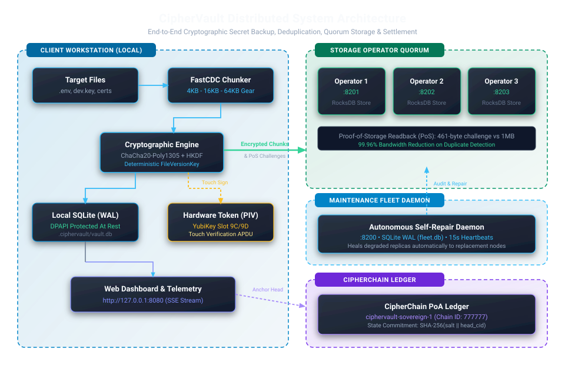
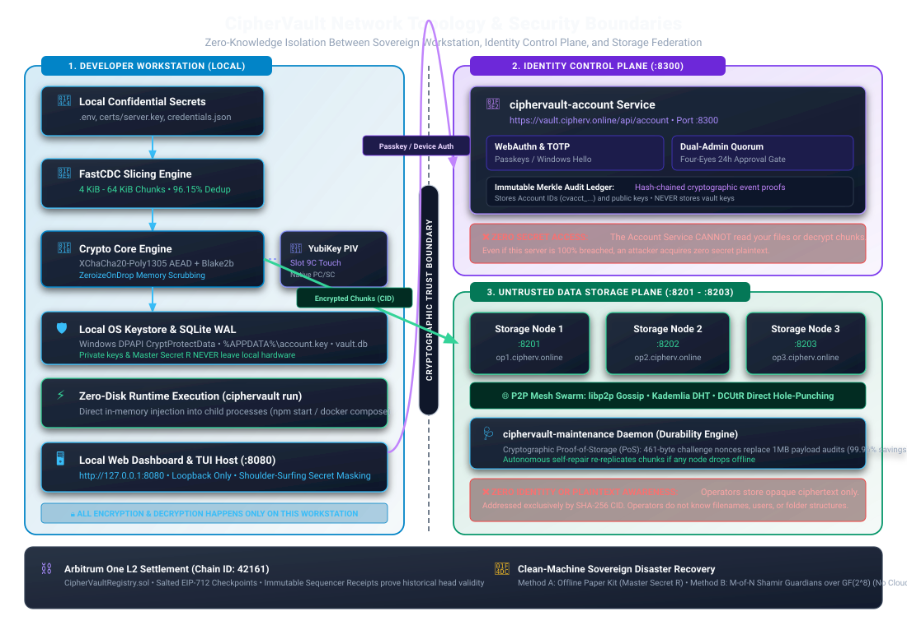
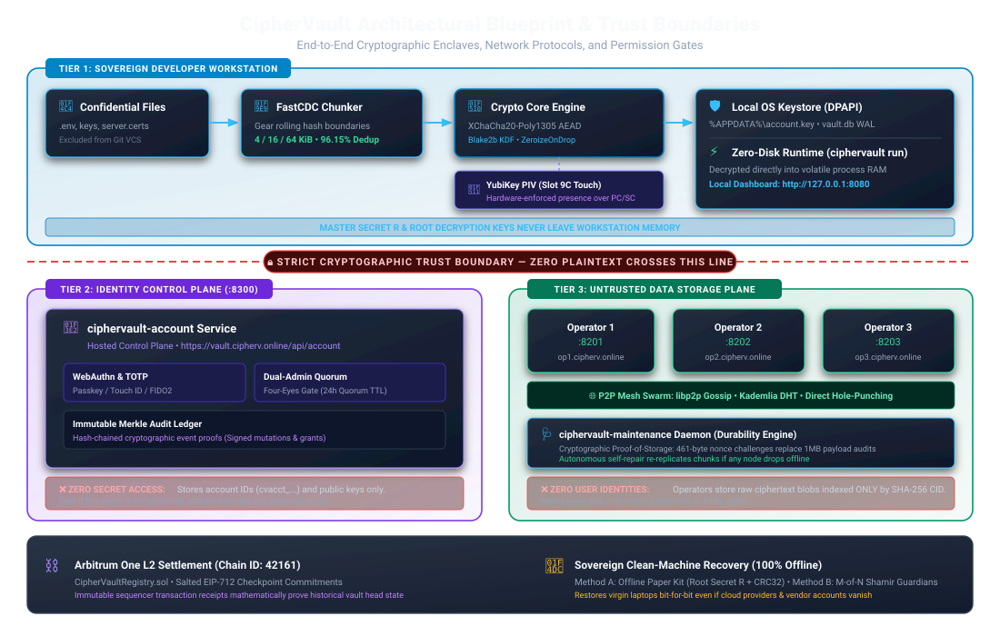
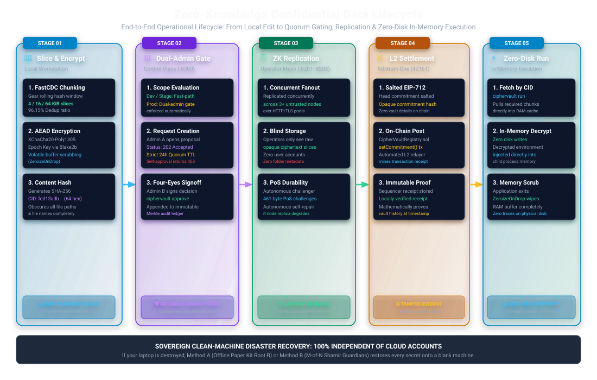
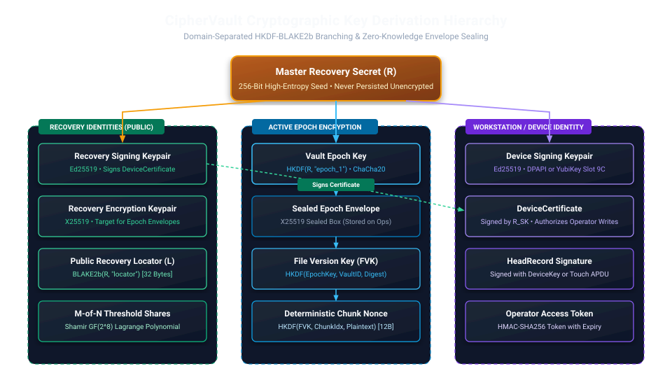
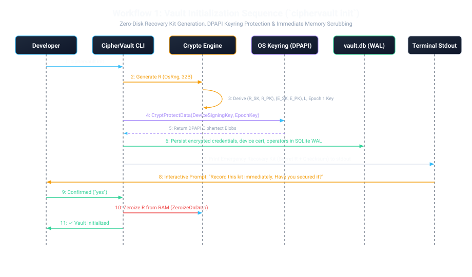
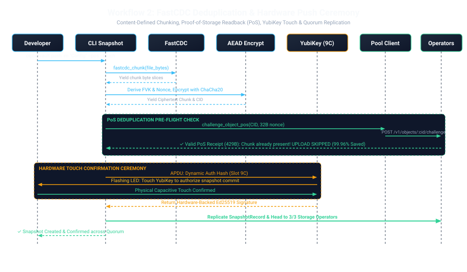
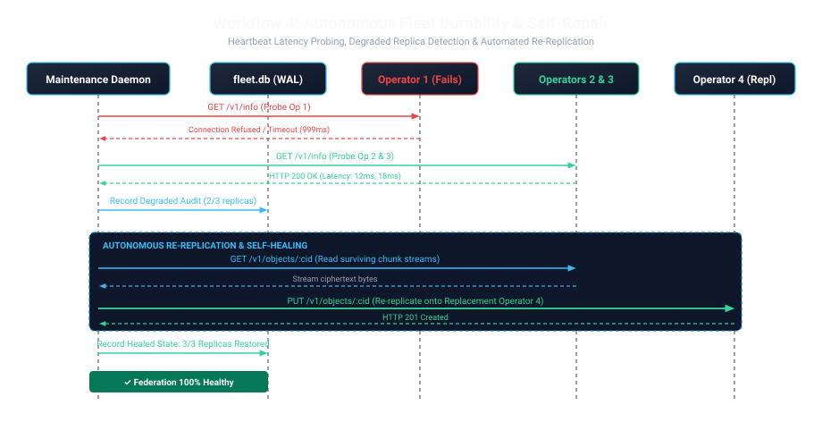
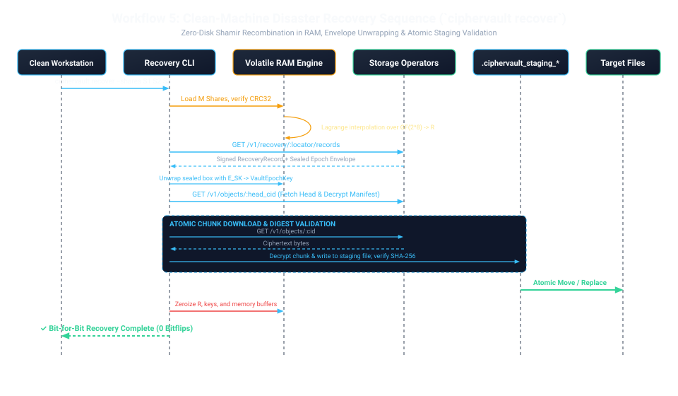

# CipherVault Operator Audit — 2026-11-08

**Scope:** `services/operator` (~12.3k lines: HTTP handlers, state, P2P swarm) + `dist/` binaries/config vs source drift.
**Method:** 5 parallel static-analysis passes with file:line evidence, plus live probing of `dist/bin/ciphervault-operator.exe` (self-reported `1.0.0`; repo source `v1.0.29`) and the public fleet.
**Trust baseline:** operators hold only ciphertext (XChaCha20-Poly1305) keyed by content digests. Nothing below breaks that — the findings are about availability, access control, and operational honesty.

## Live-verified facts (probed, not just read)

- Dist binary **404s `POST /v1/identities`** — new devices/vaults cannot enroll. (Source has it at `lib.rs:288-295`.)
- Dist binary **`GET /v1/recovery/<loc>/records` without `?cursor=` returns `{"records_hex":[]}`** even when records exist on disk. With `?cursor=0`, records return. This silently breaks `recover`/`recovery test` against dist binaries.
- Binary-embedded default fleet includes **`https://vault.cipherv.online/op/{1,2,3}` (404s)**; working fleet is `op1/2/3.cipherv.online`. Fresh `init` points new vaults at the dead fleet.
- Public fleet is **permissioned**: unknown device identities get `400 device identity is not enrolled`. Enrollment requires the fleet operator's service token.
- Strict mode can be disabled per-process (`CIPHERVAULT_OPERATOR_STRICT_AUTH=false` → open enrollment). Used for the local drill fleet only.

## Findings — Critical / High

- **Critical — dist binary cannot enroll identities.** `POST /v1/identities` 404s live; `GET /v1/identities` and `POST /v1/identities/revoke` also absent from the binary's route strings. Any deployment on dist binaries is frozen: no onboarding, no revocation. (Source: `handlers.rs:341-378`; binary string inventory.)
- **High — dist binary lacks recovery pagination.** Zero `cursor` hits in binary strings; source defaults `cursor: 0` (`handlers.rs:619-623`). Recovery reads against dist binaries return empty. (Live-verified above.)
- **High — dist binary lacks the HTTP rate limiter and trace middleware.** No `rate limit`/`trace-id` strings; source guard is 600 req/min/key, fail-closed (`lib.rs:131-263`).
- **High — dist binary lacks the peer join/graduation/membership/admissions plane and `POST /v1/chain/publish`.** Only raw gossip announce + peer list work. (`lib.rs:322-329` vs binary strings.)
- **High — dist binary lacks `/healthz`, `/metrics`, `--bind-address`, `--rotate-key`, quota/voucher flags.** CLI surface is `-p/-d/-o` only. No key rotation, no P2P flags, no quota policy, no orchestrator probes. (`main.rs:34-156` vs binary `--help`.)
- **High — plaintext HTTP + `0.0.0.0` default, no TLS option.** Bearer session tokens, service tokens, and ciphertext traverse cleartext; theft = impersonation until 1h session expiry. Protection is external (bind/firewall) and unenforced. (`main.rs:35-43`; no TLS deps in operator `Cargo.toml`.)
- **High — non-strict mode is fail-open across the control plane.** With `STRICT_AUTH=false` and no `Authorization` header, `require_control_auth` and `approval_scope` return `Ok` (`handlers.rs:83-87`, `118-135`); unenrolled identities get READ+WRITE (`methods_sessions.rs:646`). Any non-prod/default-local run on a LAN is exposed. (Used deliberately for the local drill fleet; never for anything reachable.)
- **High — service token is a single undivided root.** `IdentityRequest.permissions` is caller-controlled with no mask; any holder can self-enroll as `PERMISSION_FLEET_ADMIN` on any vault and mint vouchers. No split between "enroll" and "grant admin". (`handlers.rs:147-159` → `methods_identity.rs:101-160`.)

## Findings — Medium

- **Unauthenticated CPU-work oracles** pre-auth behind only the shared 600/min limiter: `POST /v1/chain/publish`, `POST /v1/challenges` + `/v1/sessions`, `POST /v1/peers/join`. Asymmetric CPU burn / budget-spending possible.
- **Anonymous recovery GET has no rate/budget scoping.** Capability-URL design (256-bit locator) is sound, but locator compromise is undetectable and unrevocable; deserves the strictest rate tier + read logging. (`handlers.rs:625-638`.)
- **`dist/config/operator-*.toml` is inert.** Nothing parses TOML (`main.rs` takes CLI flags only); launcher scripts use different ports/flags. Reviewed config ≠ running config.
- **Voucher/quota economics fail open by default.** `vouchers_required=false`, max single grant `u64::MAX`, lifetime cap 0=unlimited. Chained vouchers → unbounded disk unless all three switches are set together. (`methods_chain.rs:66-68`.)
- **90-day retention is advertised, not enforced.** `term_days=1` or `u32::MAX` accepted; no expiry/GC for leases, objects, or logs. (`methods_leases.rs:52-63`; `handlers.rs:246` is display text.)
- **`Bearer` parsing is case-sensitive** (`extract_token` strips only exact `"Bearer "`), so RFC-valid `bearer` clients silently downgrade to anonymous. (`handlers.rs:51-57`.)
- **No service-token strength floor.** Empty fails closed; `test` is accepted. Presence checked at strict boot, strength never. (`main.rs:244-256`.)
- **P2P routing-table poisoning pivots repair/heartbeat trust.** `RepairPush`/heartbeat checks trust whatever key the routing table holds; token compromise (or non-strict bypass) lets an attacker overwrite a victim descriptor and redirect repair pushes. `CIPHERVAULT_TRUSTED_PEER_KEYS` mitigates where set — require it with P2P repair. (`serve.rs:367-380`; `methods_peers.rs:72-81`.)
- **Unauthenticated provider-record Sybil stalls repair.** Fake "holders" can win rendezvous election then never push; digest checks prevent poisoning but availability degrades per cooldown. (`mod.rs:1153-1192`.)
- **`SwarmHandle::put_raw_record` is one call from a DHT poisoning primitive.** Same-key garbage can blank a victim's peer key (last-write-wins); restrict to `#[cfg(test)]`. (`mod.rs:484-488`.)
- **PoS nonce is caller-chosen, no server freshness; full-object hash per proof.** Fine for dedup/audit with caller-enforced freshness; weak as a standalone challenge + CPU amplification surface. (`handlers.rs:445-477`; `storage/lib.rs:30-39`.)

## Findings — Low / Info

- Recon surface unauthenticated by design: `/metrics`, `/healthz`, `/v1/info`, `/v1/peers/p2p` (PeerId, addrs, NAT view), `/v1/peers/self` (harvestable descriptors — announce still needs control auth). Firewall-or-loopback is advisory only.
- Session/challenge oldest-eviction at 5,000 capacity lets an attacker evict others' sessions (strict mode limits this to enrolled keys). (`methods_sessions.rs:371-379`, `496-507`.)
- Lease list vs renew case-sensitivity mismatch (`==` vs `eq_ignore_ascii_case`) — upper-hex vault IDs list zero leases. (`methods_leases.rs:124,176,226`.)
- Mixed-case `X-CipherVault-Id` fragments lease-ownership lookups. (`handlers.rs:495-502`.)
- Reader racing a writer gets hard 400 instead of last-committed prefix — fail-closed, minor availability wrinkle. (`methods_recovery.rs:375-381`.)
- `MAX_RECOVERY_RESPONSE_BYTES` (16 MiB) is dead on the paged path; legacy uncapped `get_recovery_records` still `pub` for P2P/tests. (`limits.rs:10,143-148`.)
- `--rotate-key` leaves timestamped key backups in the data dir indefinitely, no shredding. (`main.rs:274-280`.)
- Binary-only `/v1/relayer/checkpoints` route has zero source hits — removed/renamed since 1.0.0; pinned clients break on upgrade.
- **Positive (verified in code):** append-only recovery log (no update/delete API), first-writer-wins genesis pinning, per-log signature checks, crash-safe appends with fsync, 4 MiB object cap + body limit double-enforced, SHA-256 digest binding pre-persist, lease receipt signatures with renew re-verification, single-use Ed25519 challenges with domain separation, per-request enrollment revalidation (no TOCTOU), constant-time token compare, no secret-adjacent logging, strict gossipsub validation, fail-closed DHT/heartbeat/chain validators, repair budgets on both directions.

## What this means for the hackathon

1. **Rebuild `dist/bin` from source before the demo.** The 1.0.0 binaries are missing enrollment, pagination, rate limiting, health/metrics, and P2P controls. Every "mystery failure" hit during the rebirth (enrollment 404, empty recovery reads) traced to this drift, not the protocol.
2. **Fix the default fleet.** Fresh `init` points at dead `vault.ciphervonline` endpoints. Either repair DNS/service or change `DEFAULT_PRODUCTION_OPERATORS`.
3. **Document the permissioned-fleet story.** New users cannot self-enroll on the public fleet — that is a support ticket today. Decide: open enrollment with quotas, or an explicit onboarding flow.
4. **Never run non-strict outside loopback.** The drill fleet config (`STRICT_AUTH=false`) must not leak into any composition a judge inspects.

*Static claims cite file:line in `services/operator/src` and `crates/storage/src`; live claims were probed against dist binaries and the public fleet on 2026-11-08. Remediation status: open.*

## System architecture diagrams

Full-page interactive version (architecture + 7-stage workflow): [`../ciphervault-architecture.html`](../ciphervault-architecture.html)

