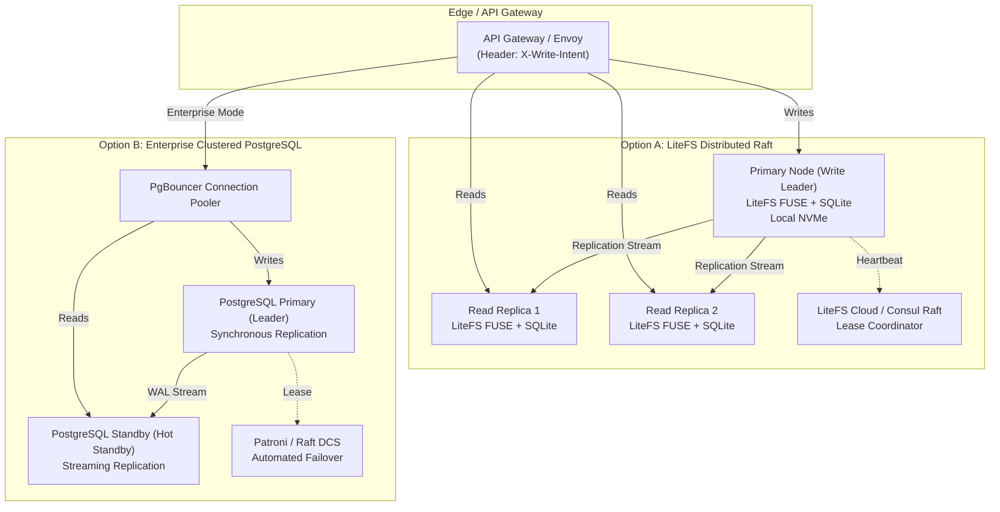

# CipherVault High-Availability Database Clustering Architecture

This document defines the high-availability (HA), multi-region clustering, and database migration architecture for the CipherVault control-plane account service (`services/account`).

---

## 1. Problem Statement & Motivation

In single-node deployments, `services/account` utilizes embedded SQLite via `rusqlite`. While SQLite provides zero-configuration simplicity and ACID transactions for single-host topologies, enterprise requirements necessitate:

1. **High Concurrency & Multi-Reader Throughput:** Horizontally scaling scoped secret retrieval across distributed application clusters.
2. **Zero-Downtime High Availability (HA):** Sub-second failover in the event of node, zone, or cloud provider failure.
3. **Audit Chain Linearizability:** Strict ordering of tamper-evident SHA-256 audit log events (`prev_hash` chaining) across distributed replicas.
4. **Disaster Recovery Isolation:** Continuous asynchronous or synchronous replication without exposing plaintext secrets to database replicas.

---

## 2. Evaluated Topologies



### Option A: LiteFS (Distributed Raft-Replicated SQLite)
- **Mechanism:** FUSE filesystem that intercepts SQLite transactions and replicates transactional LTX files via Raft consensus.
- **Pros:**
  - Zero code rewrite: applications continue to speak SQLite dialect via `rusqlite`.
  - Microsecond read latencies (reads served directly from node RAM / NVMe).
  - Built-in transaction forwarding (replicas automatically proxy write transactions to the elected leader).
- **Cons:**
  - Requires Linux FUSE kernel support in container environments.
  - Write throughput capped at ~1,000 tx/sec (bound to single leader).

### Option B: Clustered PostgreSQL (Patroni + PgBouncer)
- **Mechanism:** Dedicated multi-node PostgreSQL cluster with Patroni DCS, streaming WAL replication, and PgBouncer connection pooling.
- **Pros:**
  - Arbitrary write throughput and table partitioning.
  - Native enterprise backup ecosystem (pgBackRest, WAL-G, AWS RDS Multi-AZ, GCP Cloud SQL).
  - Mature connection multiplexing.
- **Cons:**
  - Network hop required for read queries.
  - Requires database dialect abstraction layer.

---

## 3. Abstract Database Interface Specification

To support both single-node local development, LiteFS edge clusters, and enterprise PostgreSQL without code duplication, `services/account` implements the `HaDatabaseStore` abstraction:

```rust
#[async_trait]
pub trait HaDatabaseBackend: Send + Sync {
    /// Return the active backend topology descriptor
    fn topology(&self) -> ClusterTopology;

    /// Return whether this node is currently the elected write leader
    fn is_leader(&self) -> bool;

    /// Health check and replication lag inspection
    async fn check_health(&self) -> Result<ClusterHealth, HaDatabaseError>;

    /// Execute a read-only query (routed to local replica or standby)
    async fn execute_read<F, R>(&self, f: F) -> Result<R, HaDatabaseError>
    where
        F: FnOnce(&rusqlite::Connection) -> Result<R, rusqlite::Error> + Send + 'static,
        R: Send + 'static;

    /// Execute a write transaction (strictly routed to leader)
    async fn execute_write<F, R>(&self, f: F) -> Result<R, HaDatabaseError>
    where
        F: FnOnce(&mut rusqlite::Connection) -> Result<R, rusqlite::Error> + Send + 'static,
        R: Send + 'static;
}
```

---

## 4. Audit Sequence Linearizability Invariant

Audit rows form an append-only hash chain where `row[n].prev_hash == SHA256(row[n-1])`.

In clustered read-replica configurations:
1. **Write Consensus:** Every audit insertion must acquire an `IMMEDIATE` transaction on the cluster write leader.
2. **Replication Guard:** Read replicas maintain an in-memory high-water mark of the latest replicated `audit_event_id`.
3. **Linearizability Verification:** If a client requests audit verification immediately following a write, the API gateway verifies that `replica.last_tx_id >= client.tx_id`; otherwise, the query is forwarded to the leader.
